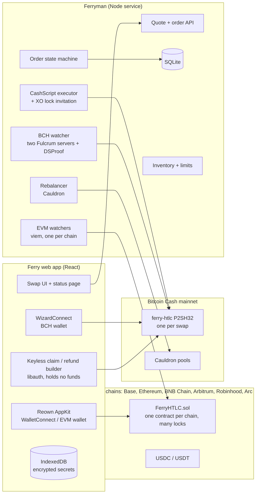

# Ferry — Engineering Blueprint (v1.2, BLAZE week)

**A ferry, not a bridge.** Ferry is a two-way, **trust-minimised atomic swap** between **stablecoins on EVM chains** (USDC first, USDT on some chains) and **PUSD / MUSD on Bitcoin Cash**, with a solver that supplies the liquidity. Nothing is wrapped, minted or held by a custodian. Each swap is two hash-time-locked contracts (HTLCs), one per chain, that unlock with the same 32-byte secret.

The counter chains are **Base, Ethereum, BNB Chain, Arbitrum, Robinhood Chain and Arc**. All are EVM chains, so one contract serves them all. Every route has Bitcoin Cash on one side.

Two simple links sit on top of the swap (§23):

- A **pay link** lets someone pay you from the chain they already use, so your friend with USDC on Arbitrum never has to buy BCH first.
- A **send link** lets you send dollars to someone who only uses another chain, such as parents on Ethereum, with the contract on that chain enforcing who can receive them and for how long.

To our knowledge Ferry is the first live, two-way stablecoin swap between Bitcoin Cash and other chains (prior art in §22).

| | |
|---|---|
| Event | BCH BLAZE 2026: hacking 14 Nov 14:00 UTC → 22 Nov 14:00 UTC; showcase 28 Nov |
| Targets | Mainnet Track · Stablecoin Bridge bounty ($750 PUSD) · one XO bounty (Migrate, 1 BCH, or Build, 0.3 BCH; see §14.3) |
| Document status | **v1.2, 15 Nov 2026 (Day 2 of 8).** Supersedes v1.0 of 22 Oct 2026. |
| Prior work | [`ferry-testnet`](https://github.com/deyoungjohn/ferry-testnet): a public testnet implementation built before kick-off, disclosed in the banner. **The main repository, `ferry`, is a new repository. It is not a fork of `ferry-testnet`.** |
| Preparation | This blueprint and the spike results from the testnet work live in the `/preparation` folder of the main repository. |

> **Rules note.** Verified on the DoraHacks detail page on 22 Oct: pre-existing work is allowed, but must be disclosed in the homepage banner with links to the **old repo, the new repo, and a demo of the project as it stood before the hackathon began**. Projects must also be "original or significantly improved during the hackathon".
>
> Reported in the community streams and **not yet confirmed on a rules page**: the starting point needs its own *hosted* demo next to the final one; planning documents go in a `/preparation` folder; judges are told to penalise ambiguous submissions. This blueprint plans for the stricter reading and asks the organisers to confirm (§15).
>
> **Submission window (DoraHacks timeline, UTC):** opened **13 Nov 13:00**; hard deadline **22 Nov 14:00**. Judging runs 23–27 Nov; winners are announced 28 Nov.

### How to read the sources

- ✔ **Verified**: checked against a primary source, with the date given.
- ◇ **Reported**: taken from community streams or third-party pages, and not confirmed against a primary source. Treat it as direction, and verify before relying on it.

### What changed in v1.2

| Area | v1.0 (22 Oct) | v1.2 (15 Nov) | Section |
|---|---|---|---|
| Starting point | Contracts and spikes only, built before kick-off | `ferry-testnet` is disclosed as the pre-BLAZE testnet work. The main repo is new and is built during the event. Not a fork. | §12 |
| Counter chains | Base first; seven networks, ten routes | **Base, Ethereum, BNB Chain, Arbitrum, Robinhood Chain and Arc.** All EVM, one contract. USDC is the main counter token; USDT is added on chains where it is reliable. Solana and Tron move to after the event. | §1, §24 |
| Payment links | Invoices and open tip links | **Pay links and send links.** No invoices: Ferry is for people, not for business billing. | §23 |
| XO | XO engine executes lock, claim and refund | Spike result: the engine cannot execute our claim or refund. CashScript executes; the XO template is a byte-identical specification and builds the lock address. | §5.1, §10, §14.3 |
| XO bounty | 0.3 BCH × 10, first 10 qualifying | Best 10, not first 10. A second bounty, Migrate to XO, pays 1 BCH to up to 5 winners. Feedback written by AI is rejected. | §14.3 |
| Judge path | Either direction | Lead with **PUSD → USDC**: judges already hold PUSD and only paste an EVM address | §13, §19 |
| Launch | Mainnet on Day 6 | Mainnet by **Day 3–4**, shared publicly, so real swaps happen during the week | §12 |
| Decentralisation | "Open the solver role" after the event | Open-source solver with a runbook, multi-solver quotes and an IPFS mirror this week; permissionless discovery as a stretch | §25 |
| Wording | "trustless" in places | "Trust-minimised atomic swap with a solver for liquidity" everywhere | §22 |

### Open items

1. **Token availability per chain.** Robinhood Chain and BNB Chain may not have an issuer-published USDC. Those routes ship only with a verified token contract (§24.2).
2. **Selene on mainnet.** A judge leads Selene; it must complete a swap before launch.
3. **Organisers' answers** on how prior work must be disclosed (§15).
4. **Funding the mainnet addresses** and approving each 🔒 mainnet action (§12).

---

## Table of contents

1. Requirements
2. System overview
3. Swap protocol
4. Timelock and confirmation safety
5. Module specifications
6. Tech stack and pinned versions
7. Environment setup
8. Configuration
9. Security and threat model
10. Feasibility: results from the testnet work
11. Test plan and empirical spikes
12. Build timeline (15 → 22 Nov)
13. Demo plan
14. Eligibility and bounty checklist
15. Open questions for sponsors
16. Risk register
17. After the event
18. Appendix: canonical data
19. Judging criteria alignment
20. Frontend design system (theme + liquid glass)
21. Solver inventory sizing
22. Positioning and prior art
23. Pay links and send links
24. Multi-chain support (EVM)
25. Permissionless, trustless, decentralised: what we can honestly claim

---

## 1. Requirements

> **Updated 15 Nov.** Six EVM counter chains, pay links and send links. No invoices.

### 1.1 Functional

| ID | Requirement | Source | Status from the testnet work |
|---|---|---|---|
| FR-1 | Swap a stablecoin on an enabled EVM chain (USDC first, USDT where listed) → PUSD on Bitcoin Cash | Bridge bounty: "other-chain stables into BCH stables" | Works on testnets; mainnet pending |
| FR-2 | Swap PUSD (BCH) → the stablecoin on the chosen EVM chain | Bridge bounty: "and vice-versa" | Works on testnets; mainnet pending |
| FR-3 | Same two directions for MUSD | Bounty stretch goal: "supporting multiple [BCH stablecoins] would be better" | Same covenant, different category |
| FR-4 | BCH wallet connection via WizardConnect | Bounty "highly recommended"; Mainnet Track requirement | Works with Paytaca. **Selene must pass on mainnet** (a judge leads Selene). |
| FR-5 | EVM wallet connection via WalletConnect (Reown AppKit) on every enabled chain | Bounty "probably essential" | Works on Base Sepolia; other chains by configuration |
| FR-6 | Every swap ends in exactly one of: *completed*, or *both sides refunded*. No third outcome. | Core safety property | Held in every testnet swap, including the failed ones |
| FR-7 | A user can finish (claim or refund) **without the Ferry website or solver**, using a downloadable recovery file | Liveness | Works; the recovery page is direction-aware |
| FR-8 | The BCH HTLC is published as an **XO template whose locking bytecode is byte-identical to the CashScript contract**. The XO engine derives the lock address and builds the lock invitation, which is inspected in the XO debug tool. Claim and refund execute through CashScript and libauth. | XO bounty; spikes S-01/S-02 | Parity proven; engine execution of claim/refund not possible today (§5.1) |
| FR-9 | Live status page per swap, with explorer links for every transaction on both chains | Demo, trust | Works |
| FR-10 | **Pay links:** a BCH user shares a link; whoever opens it pays from the chain and stablecoin they already hold, and PUSD or MUSD lands in the BCH user's wallet (§23.1) | Product depth: people get paid without asking the payer to buy BCH | Works on testnet; never tried with an outside payer |
| FR-11 | **Send links:** a BCH user sends dollars to a person who only uses another chain. The link names the destination chain, the receiving address and a time window; the contract on that chain enforces them (§23.2) | Product depth: family and friends on other chains | New; design in §23.2 |
| FR-12 | **Six EVM counter chains:** Base, Ethereum, BNB Chain, Arbitrum, Robinhood Chain, Arc. One contract, configured per chain. USDC is the main counter token, USDT is added where reliable. A route is enabled only after its own mainnet acceptance (§24.5). | Bounty: "multiple ecosystems would be better" | Base Sepolia, Arbitrum, BNB Chain testnets tested; Ethereum and Arc bytecode-checked; Robinhood Chain not yet tested |
| FR-13 | **My Activity is rebuilt from the Bitcoin Cash chain**, not from our database: the user's swaps are found from their BCH address and joined to EVM locks by hash lock | Trust, BCH as the main chain | Works on testnet |
| FR-14 | **Multi-solver quotes:** the web app takes a list of solver URLs, verifies each signed quote and uses the best one | Decentralisation (§25) | New this week |
| FR-15 | **Required banner** on the home page: deck, repo, token-aware address for EMBER2026 votes, prior repo and prior demo | Event rules | New this week |
| FR-16 | *Stretch:* the static site and the recovery page are also served from IPFS | Decentralisation (§25) | New this week |

### 1.2 Non-functional

| ID | Requirement | Target |
|---|---|---|
| NFR-1 | Forward swap wall time, fast lane (≤ `ZERO_CONF_MAX_USD`) | < 60 s median |
| NFR-2 | Forward swap wall time, safe lane | ~1 BCH block (≈10 min median) + < 60 s |
| NFR-3 | User-side fees (excluding spread) | < $0.05 per swap on L2s and BNB Chain; Ethereum may cost more (§24.2) |
| NFR-4 | Solver crash at any state → no loss of funds; resumes from DB plus chain rescan | Required |
| NFR-5 | No admin keys, upgradeability or pause function on either contract | Required |
| NFR-6 | The secret never appears in a server request, log line or analytics event. A send link carries it only in the URL fragment, which browsers do not send. | Required |
| NFR-7 | A judge holding only PUSD completes PUSD → USDC in under 2 minutes with a pasted EVM address | Required (§19) |
| NFR-8 | Every wait on screen names what it is waiting for, and the user's steps are separate from the solver's | Required |
| NFR-9 | Every claim in the UI, deck and README is one we can show on chain. No inflated wording (§22). | Required |
| NFR-10 | Payment wording follows the mode: swap, pay link, send link. Never "invoice", "bill" or "tip". | Required |

### 1.3 Out of scope for the event

- Solana and Tron routes, and any chain that is not EVM (§17).
- Invoices, billing, accounting exports and merchant dashboards. Pay links are for people.
- The other bounties: SolidCash, DID/Nostr and FoldingCash. They need different stacks.
- XO engine execution of claim and refund (not possible with the current engine).
- A browser-extension BCH wallet adapter (the Paytaca extension injects no provider).
- Routes that don't touch Bitcoin Cash · solver auctions · THORChain or ShapeShift routing (outreach, §17) · minting or redeeming PUSD or MUSD through the protocols · loan positions.

---

## 2. System overview

### 2.1 Components



> **Updated 15 Nov.** The two "XO engine" boxes of v1.0 are replaced. The engine cannot spend a covenant output it did not create (§5.1), so the browser builds the keyless claim and refund with libauth, and the solver executes with CashScript. The XO template remains the published specification of the same script.

### 2.2 Naming

| Thing | Name |
|---|---|
| Product and web app | **Ferry** |
| Solver service | **Ferryman** |
| XO template | `ferry-htlc` |
| EVM contract | `FerryHTLC` (one deployment per chain) |
| Packages | `@ferry/core`, `@ferry/htlc-bch`, `@ferry/htlc-evm`, `@ferry/solver`, `@ferry/web` (check npm scope availability; fall back to `@ferryswap/*`) |

### 2.3 Key design decisions

1. **The user is always the initiator.** The user generates the secret, locks first, and gets the longer timeout in both directions. The user never has to trust the solver's software for safety; they only rely on its liquidity.
2. **The BCH contract is a covenant with fixed payees.** Both branches force the output to a locking bytecode fixed in the contract. The claim needs only the preimage, with no signature. Consequences:
   - Anyone can broadcast the claim or refund. Watchtowers and the solver can finish a swap for the user, and funds can still only go to the right party.
   - The browser's XO engine never holds funds, so there is no ephemeral-key custody problem (the Hashport and Tab weakness).
   - WizardConnect only needs to provide an address (forward) and fund one output (reverse). It never has to sign a custom script input, which removes the largest wallet-compatibility unknown.
3. **The EVM contract mirrors this.** `claim()` and `refund()` are permissionless and pay fixed recipients.
4. **BCH refund locks use block height, never time.** BCH CLTV compares time-based locks to median-time-past, which lags wall-clock time by about an hour.
5. **The preimage is exactly 32 bytes on both chains.** A length mismatch between chains is a classic HTLC bug that can make one side unclaimable.
6. **One BCH script per swap; one EVM contract for all swaps.** On BCH the swap terms are constructor parameters, so each swap gets its own P2SH32 address. That gives clean watching, and a public commitment to the terms.
7. **The CashScript artifact executes; the XO template specifies.** *(New.)* Both compile to the same locking bytecode, which a test checks. Anything that spends the covenant uses the CashScript and libauth path.
8. **The chains are the record; the solver's database is a cache.** *(New.)* The status page, My Activity and the recovery page can all be rebuilt from the two chains and the user's recovery file. A swap never depends on our database surviving.
9. **Claim and refund never need a connected wallet.** *(New.)* They are keyless covenant spends, so the page broadcasts them by itself, even when the phone wallet is asleep.
10. **Any solver can serve the protocol.** *(New.)* The solver's identity is only a key inside the signed terms. Nothing in either contract names Ferry's solver (§25).

---

## 3. Swap protocol

### 3.1 Order terms (canonical object)

```ts
type Direction = "EVM_TO_BCH" | "BCH_TO_EVM";

interface OrderTerms {
  version: 1;
  direction: Direction;
  bchToken: "PUSD" | "MUSD";
  bchTokenCategory: Hex32;          // display byte order
  bchTokenAmount: bigint;           // base units (2 decimals)
  evmAmount: bigint;                // stablecoin base units (6 decimals; 18 on BNB Chain)
  evmToken: Address;                // USDC or USDT contract on that chain
  evmChainId: number;               // 8453 Base, 1 Ethereum, 56 BNB Chain, 42161 Arbitrum, 4663 Robinhood ◇, Arc: verify
  evmHtlc: Address;                 // FerryHTLC deployment on that chain
  userEvmAddress: Address;
  userBchLockingBytecode: Hex;      // P2PKH from the WizardConnect receive address
  solverEvmAddress: Address;
  solverBchLockingBytecode: Hex;
  hashLock: Hex32;                  // sha256(secret), secret is 32 bytes
  evmDeadline: number;              // unix seconds
  bchRefundHeight: number;          // absolute block height
  bchCarrySats: bigint;             // BCH carried in the HTLC UTXO, pays the claim/refund fee
  bchMaxFee: bigint;
  quoteId: string;
  quoteExpiry: number;
}
```

- `orderId = sha256(canonicalCBOR(terms))`.
- The solver signs `orderId` (secp256k1, EIP-191 personal sign with the solver's EVM key). The user verifies the signature before locking anything.
- *Notes from the testnet build.* The page checks that the signed terms match what the user asked for before the button is enabled, and a refreshed quote always gets a new secret and hash lock.

### 3.2 Forward: stablecoin → PUSD (EVM_TO_BCH)

```mermaid
sequenceDiagram
  autonumber
  participant U as User (browser)
  participant S as Ferryman
  participant B as EVM chain / FerryHTLC
  participant C as BCH / ferry-htlc
  U->>U: secret ← 32 random bytes; H = sha256(secret)
  U->>S: quote request (amount, PUSD, user addresses, H)
  S-->>U: signed terms (evmDeadline = now+24h, bchRefundHeight = tip+36)
  U->>U: save encrypted secret + recovery file
  U->>S: sign permit + LockIntent (EIP-712, no gas)
  S->>B: lockWithIntent(user, token, recipient=solver, H, evmDeadline)  [relayed]
  S->>B: observe Locked; wait EVM_CONFS
  S->>S: check terms, inventory, timing invariant (§4)
  S->>C: fund ferry-htlc(recipient=user, refund=solver, H, height)  [CashScript; address matches the XO template]
  U->>C: observe lock; verify script hash = expected; wait reveal policy (§4.3)
  U->>C: claim(secret) → PUSD to user's address  [keyless covenant spend, sent automatically]
  U->>S: POST /orders/:id/secret  (cooperative, optional)
  S->>C: (sees secret in mempool or from POST)
  S->>B: claim(id, secret) → USDC to solver
```

### 3.3 Reverse: PUSD → stablecoin (BCH_TO_EVM)

```mermaid
sequenceDiagram
  autonumber
  participant U as User (browser)
  participant S as Ferryman
  participant B as EVM chain / FerryHTLC
  participant C as BCH / ferry-htlc
  U->>U: secret, H
  U->>S: quote request
  S-->>U: signed terms (bchRefundHeight = tip+144, evmDeadline = now+6h)
  U->>C: fund ferry-htlc(recipient=solver, refund=user, H, height)  [WizardConnect-signed send]
  S->>C: observe; wait BCH reveal policy for *user's* lock (§4.3)
  S->>B: lock(token, recipient=user, H, evmDeadline)
  U->>B: observe; wait EVM_CONFS
  U->>B: claim(id, secret) → USDC to user  (or relayed, see 5.4)
  S->>B: read Claimed(id, secret) event
  S->>C: claim(secret) → PUSD to solver
```

### 3.4 Abort paths

| Situation | Outcome |
|---|---|
| Solver never locks (either direction) | The user refunds after their own timeout. Permissionless, so anyone, including the recovery page, can trigger it. |
| User never claims after the solver locks | The solver refunds after its shorter timeout. The user's lock then refunds after the longer timeout. |
| User claims, solver offline | The secret is public on chain. Ferryman catches up on restart. Margins (§4) give it hours to claim. |
| Quote expires before the user locks | No funds move. The solver rejects late locks: Ferryman refuses to counter-lock and the user refunds. The UI blocks locking after expiry. |

**Notes on both flows (from the testnet build).**
- The forward claim and the reverse claim are both automatic. A manual button stalled real swaps for minutes.
- Before signing, the page checks the user's stablecoin or PUSD balance and says so plainly if it is short.
- Before locking a stablecoin, the solver approves the exact amount.

### 3.5 Pricing

- `out = in × (1 − SPREAD_BPS / 10_000) − FIXED_FEE`, converted between 6 and 2 decimals with **floor** rounding in the solver's favour. The rounding is disclosed in the quote.
- **Peg guard:** the solver refuses to quote if `|pusdUsdPrice − 1| > PEG_TOLERANCE`, using the Paryon stats API, or if the Cauldron spot price for the token disagrees by more than the tolerance. For MUSD, only the Cauldron spot is used.
- A quote is valid for `QUOTE_TTL_S`, and is capped by `MAX_SWAP_USD` and by solver inventory minus open exposure.

---

## 4. Timelock and confirmation safety

### 4.1 Invariants

Let `t₀` be the moment the solver counter-locks. Write `ΔBCH(n)` for the wall time BCH needs to produce `n` blocks (≈ n × 10 min, Poisson-distributed, with the ASERT difficulty adjustment pulling it back to target).

**Forward (user locks on the EVM chain, solver locks on BCH)**

- The solver's BCH refund opens at height `t₀_height + N_fwd`.
- Worst case for the solver: the user claims on BCH just as the refund opens. The secret becomes public at about `t₀ + ΔBCH(N_fwd)`.
- The solver must then claim on the EVM chain before `evmDeadline`.
- **Invariant F:** `evmDeadline − t₀ ≥ P99.99[ΔBCH(N_fwd)] + SOLVER_REACTION + SAFETY`.
- Default values: `N_fwd = 36` (≈6 h expected); evmDeadline = lock + 24 h; checked at t₀ with `SAFETY = 2 h`. 36 blocks taking more than 20 h would need a sustained average above 33 min per block, which is effectively impossible under ASERT outside a chain halt. **During a halt the solver stops quoting** (tip-age monitor, §5.3).

**Reverse (user locks on BCH, solver locks on the EVM chain)**

- The solver's Base refund opens at `evmDeadline = t₀ + 6 h`.
- Worst case for the solver: the user claims on the EVM chain at `evmDeadline − ε`. The solver must then claim on BCH before the user's refund height.
- **Invariant R:** time to reach `bchRefundHeight` from t₀ must be ≥ `6 h + SOLVER_REACTION + SAFETY` at P0.01 (fast blocks).
- Defaults: `N_rev = 144` (≈24 h). The solver counter-locks only if `bchRefundHeight − tip ≥ 108` (≈18 h expected). 108 blocks arriving in under 8 h would need a sustained average below 4.5 min per block, which is negligible.

Both invariants are enforced in code (`@ferry/core/timing.ts`): the solver refuses to counter-lock, and the UI refuses to claim, when they fail.

### 4.2 Claims stay valid after the deadline

Neither chain can enforce "claim only *before* height X". BCH `nLockTime` sets a lower bound only, and the EVM contract deliberately mirrors that. After a timeout both branches are valid and the first transaction to confirm wins. This is safe because of the invariants above. The UI says so plainly.

### 4.3 Reveal policy (when to expose the secret)

The secret may only be revealed after the counterparty's lock is **irreversible enough**. If it is revealed against an unconfirmed lock, the counterparty can double-spend their own lock *and* use the revealed secret to claim the other leg.

| Counterparty lock on | Amount ≤ `ZERO_CONF_MAX_USD` (fast lane) | Above (safe lane) |
|---|---|---|
| BCH | 0-conf, after a `DSPROOF_WINDOW_MS` window with no double-spend proof (Fulcrum `blockchain.transaction.dsproof.subscribe`) | ≥ 1 confirmation |
| EVM chain | ≥ the chain's fast-lane confirmations (§24.2; Base: 10 blocks, ≈20 s) | The chain's `safe` or `finalized` tag |

- **Fast lane is opt-in per swap.** The UI shows a one-line risk disclosure, and the cap is enforced on both client and solver.
- The same rule protects the solver in reverse: it counter-locks USDC only after the user's BCH lock meets the lane's threshold.

> **Updated 15 Nov: this is built, and it is a Bitcoin Cash feature worth showing.**
> - Spike S-05 passed. Both mainnet Fulcrum servers report double-spend-proof support, and the median time from broadcast to notification on chipnet was about 1.0 s.
> - The solver already applies the rule: for a fast-lane lock with no confirmations it asks Fulcrum for a double-spend proof, waits the 5 s window, and refuses to counter-lock if a proof appears. Tests cover the contested case.
> - A fast-lane reverse swap finished in 19 s on chipnet.
> - **Not yet seen:** a real double-spend attempt against a lock on mainnet. Until then the fast lane keeps its $25 cap and its opt-in.
> - **This week:** show it in the UI ("no double-spend seen for 5 s") and in the deck. It is the one place where Ferry uses something only BCH has.

---

## 5. Module specifications

### 5.1 `@ferry/htlc-bch`: the BCH contract

**Reference implementation (CashScript):**

```solidity
pragma cashscript ^0.11.0;

// One instance per swap. All parameters are public on-chain once spent.
contract FerryHTLC(
    bytes32 hashLock,                 // sha256(secret)
    bytes   recipientLockingBytecode, // claim payee
    bytes   refundLockingBytecode,    // refund payee
    bytes32 tokenCategory,            // INTERNAL byte order (reversed vs display hex)
    int     tokenAmount,
    int     refundHeight,             // absolute block height (< 500,000,000)
    int     maxFee                    // sats the spend may burn as miner fee
) {
    function claim(bytes secret) {
        require(secret.length == 32);
        require(sha256(secret) == hashLock);
        require(this.activeInputIndex == 0);
        require(tx.inputs.length == 1);
        require(tx.outputs.length == 1);
        require(tx.outputs[0].lockingBytecode == recipientLockingBytecode);
        require(tx.outputs[0].tokenCategory == tokenCategory);
        require(tx.outputs[0].tokenAmount == tokenAmount);
        require(tx.outputs[0].value >= tx.inputs[0].value - maxFee);
    }

    function refund() {
        require(tx.time >= refundHeight);      // CLTV on block height
        require(this.activeInputIndex == 0);
        require(tx.inputs.length == 1);
        require(tx.outputs.length == 1);
        require(tx.outputs[0].lockingBytecode == refundLockingBytecode);
        require(tx.outputs[0].tokenCategory == tokenCategory);
        require(tx.outputs[0].tokenAmount == tokenAmount);
        require(tx.outputs[0].value >= tx.inputs[0].value - maxFee);
    }
}
```

**Notes:**
- **Byte order.** Token categories are displayed in reversed (RPC) byte order. Introspection returns internal order. Get this wrong and every claim fails. There is a test for it (BCH-U-07).
- **Fee carry.** The funding output carries `bchCarrySats` (default 3,000). The spend keeps at least `value − maxFee` (default `maxFee` 1,500). A one-input, one-output claim is about 350–450 bytes, so ≈450 sats at 1 sat/B, leaving the token output well above dust.
- **Refund transactions** must set `nLockTime ≥ refundHeight` and a non-final input sequence (`0xfffffffe`).
- **Exact `tokenAmount` equality** prevents partial or split spends. The token must be fungible only: no NFT and no capability, enforced by the category length and equality check.
- **Address:** P2SH32 token-aware cashaddr (`bitcoincash:r…`). The redeem script is roughly 200 bytes, well within limits.
- **Recovery data:** the full constructor parameters go in the recovery file, so the script can always be rebuilt.

> **Updated 15 Nov: what the XO spike found.**
> - **Parity: pass.** The CashAssembly template compiles to locking bytecode that is byte-for-byte identical to the CashScript artifact. A test keeps it that way.
> - **Lock: partial.** The engine imports the template, creates the lock invitation and derives the correct P2SH32 address. A covenant funded at that address on chipnet was then claimed with the CashScript builder. The engine could not sign the funding transaction by itself.
> - **Claim and refund: no.** The engine only spends outputs that its own account tracked from creation, and its signing pipeline expects key signatures. A keyless spend that reveals a preimage, by a party who did not create the output, does not fit.
> - **Consequence.** CashScript and libauth execute all three actions. The XO template is the published, verified-equivalent specification, and the source of the lock invitation shown in the debug tool.
> - **Other findings** (decode mode for token categories, numeric literals, the unfinished SQLite storage, string amounts read as bytes) are noted in the spike results. The bounty rejects AI-written feedback ✔, so **the team lead writes the submitted essay** from their own experience.
> - **Still to ask General Protocols:** whether a newer engine release changes any of this (◇ the kickoff stream mentioned a fresh npm release for BLAZE), and which bounty we fit (§14.3).

**XO template `ferry-htlc`:** the same script transcribed to CashAssembly in the working XO schema. Schema rules from the gap analysis:
- `inputs.<i>.unlockingScript`, never `unlockingBytecode`.
- `actions.<a>.unlockingScripts`, never a root-level `unlockingScripts`.
- No `defaultOutput`.
- Variables written as `$(<var>)`.
- Serialise with `serializeTemplate`, never `JSON.stringify`.

| Template element | Content |
|---|---|
| Entities | `locker`, `claimer`, `refunder` |
| Variables | `hashLock`, `recipientLockingBytecode`, `refundLockingBytecode`, `tokenCategory`, `tokenAmount`, `refundHeight`, `maxFee`, `secret` |
| Locking script | `htlc` (CashAssembly mirror of the contract above) |
| Action `lock` (starting) | Funds one output to `htlc` with the token amount and carry sats. Signed by the `locker` wallet. |
| Action `claim` | Spends `htlc` with unlocking `<secret> <branch=claim>`. Needs no key. |
| Action `refund` | Spends `htlc` with `<branch=refund>`, setting `nLockTime = refundHeight`. Needs no key. |

In the table above, the `claim` and `refund` actions are written in the template so that it is complete, but the current engine cannot execute them.

**Equivalence test (BCH-E-01):** the CashScript and XO versions produce identical locking bytecode for the same parameters (passing, when the template is compiled with hex evaluation mode). **The CashScript artifact is the source of truth and the executor; the XO template is the specification.**

### 5.2 `@ferry/htlc-evm`: `FerryHTLC.sol`

```solidity
// SPDX-License-Identifier: MIT
pragma solidity 0.8.28;

import {IERC20} from "@openzeppelin/contracts/token/ERC20/IERC20.sol";
import {IERC20Permit} from "@openzeppelin/contracts/token/ERC20/extensions/IERC20Permit.sol";
import {SafeERC20} from "@openzeppelin/contracts/token/ERC20/utils/SafeERC20.sol";
import {ReentrancyGuard} from "@openzeppelin/contracts/utils/ReentrancyGuard.sol";
import {ECDSA} from "@openzeppelin/contracts/utils/cryptography/ECDSA.sol";

contract FerryHTLC is ReentrancyGuard {
    using SafeERC20 for IERC20;

    enum State { None, Locked, Claimed, Refunded }

    struct Lock {
        address token;
        address sender;
        address recipient;
        uint256 amount;
        bytes32 hashLock;
        uint64  deadline;
        State   state;
    }

    mapping(bytes32 => Lock) public locks;

    event Locked(bytes32 indexed id, address indexed sender, address indexed recipient,
                 address token, uint256 amount, bytes32 hashLock, uint64 deadline);
    event Claimed(bytes32 indexed id, bytes32 secret);
    event Refunded(bytes32 indexed id);

    error AlreadyExists(); error NotLocked(); error BadSecret(); error TooEarly();
    error BadParams();

    // EIP-712 intent: binds a relayed lock to the owner's exact terms.
    bytes32 public constant LOCK_INTENT_TYPEHASH = keccak256(
        "LockIntent(address token,address recipient,uint256 amount,bytes32 hashLock,uint64 deadline,uint256 intentDeadline)"
    );
    bytes32 public immutable DOMAIN_SEPARATOR; // set in constructor: name "FerryHTLC", version "1", chainId, this

    // id is bound to the funds' owner so nobody can front-run a lock with the same hashLock.
    function lockId(address sender, bytes32 hashLock) public pure returns (bytes32) {
        return keccak256(abi.encode(sender, hashLock));
    }

    function lock(address token, address recipient, uint256 amount,
                  bytes32 hashLock, uint64 deadline) external nonReentrant returns (bytes32) {
        return _lock(msg.sender, token, recipient, amount, hashLock, deadline);
    }

    // Gasless lock: a relayer (Ferryman) submits the owner's EIP-2612 permit and EIP-712 intent.
    // The intent signature is essential: a permit alone authorises an amount, not a recipient,
    // so without it a malicious relayer could lock the owner's USDC to itself.
    // Replay is impossible: the id derives from (owner, hashLock) and each id is single-use.
    function lockWithIntent(address owner, address token, address recipient, uint256 amount,
                            bytes32 hashLock, uint64 deadline, uint256 intentDeadline,
                            bytes calldata intentSig,
                            uint256 permitDeadline, uint8 v, bytes32 r, bytes32 s)
        external nonReentrant returns (bytes32)
    {
        if (block.timestamp > intentDeadline) revert BadParams();
        bytes32 digest = keccak256(abi.encodePacked("\x19\x01", DOMAIN_SEPARATOR, keccak256(abi.encode(
            LOCK_INTENT_TYPEHASH, token, recipient, amount, hashLock, deadline, intentDeadline))));
        if (ECDSA.recover(digest, intentSig) != owner) revert BadParams();   // OZ ECDSA (or SignatureChecker for smart wallets)
        // try/catch: a front-run permit must not brick the lock
        try IERC20Permit(token).permit(owner, address(this), amount, permitDeadline, v, r, s) {} catch {}
        return _lock(owner, token, recipient, amount, hashLock, deadline);
    }

    function _lock(address owner, address token, address recipient, uint256 amount,
                   bytes32 hashLock, uint64 deadline) internal returns (bytes32 id) {
        if (amount == 0 || recipient == address(0) || deadline <= block.timestamp) revert BadParams();
        id = lockId(owner, hashLock);
        if (locks[id].state != State.None) revert AlreadyExists();
        locks[id] = Lock(token, owner, recipient, amount, hashLock, deadline, State.Locked);
        IERC20(token).safeTransferFrom(owner, address(this), amount);
        emit Locked(id, owner, recipient, token, amount, hashLock, deadline);
    }

    // Permissionless: funds can only go to the fixed recipient.
    function claim(bytes32 id, bytes32 secret) external nonReentrant {
        Lock storage l = locks[id];
        if (l.state != State.Locked) revert NotLocked();
        if (sha256(abi.encodePacked(secret)) != l.hashLock) revert BadSecret();
        l.state = State.Claimed;
        IERC20(l.token).safeTransfer(l.recipient, l.amount);
        emit Claimed(id, secret);
    }

    // Permissionless after the deadline: funds can only go back to the sender.
    function refund(bytes32 id) external nonReentrant {
        Lock storage l = locks[id];
        if (l.state != State.Locked) revert NotLocked();
        if (block.timestamp < l.deadline) revert TooEarly();
        l.state = State.Refunded;
        IERC20(l.token).safeTransfer(l.sender, l.amount);
        emit Refunded(id);
    }
}
```

**Notes:**
- The `bytes32 secret` parameter makes the preimage exactly 32 bytes by construction, matching the BCH side's `secret.length == 32`.
- `sha256` is the EVM precompile, matching BCH `OP_SHA256`.
- There is no owner, upgrade path or pause. The token is a parameter, but the solver and UI only accept the token addresses in the chain configuration (§24), each taken from the issuer's documentation.
- **Gas-free for users in both directions.**
  - Forward: the user signs two off-chain messages (USDC permit + lock intent), and Ferryman submits `lockWithIntent`.
  - Reverse: Ferryman relays the user's `claim`.
  - On chains whose stablecoin supports EIP-2612 permits, the user therefore never needs the chain's gas token. Ferryman's gas costs (fractions of a cent on L2s, more on Ethereum) are covered by the spread. Chains without permits (BNB Chain, Ethereum USDT) need one approval from the user (§24.2).
  - This matters because judges must be able to "simply click" and use the demo (§19).
- **USDC blocklist edge case:** if Circle blocklists the recipient, `claim` reverts and the lock is resolved by `refund` instead. If the sender is blocklisted too, funds stay in the contract. This is documented and out of our control.
- **Deployment:** deterministic CREATE2 through the canonical factory, so the address is the same on every chain that has the factory (checked per chain), and is verified on that chain's explorer. Where the factory is missing the contract is deployed normally and its address recorded in the chain configuration (§24.2).

### 5.3 `@ferry/solver`: Ferryman

**Responsibilities:**
- Quote and sign terms, and enforce limits and timing invariants.
- Watch both chains and drive each order's state machine.
- Hold hot keys for small inventory.
- Rebalance inventory.

**Order state machine (forward):**

```
QUOTED
  → USER_LOCK_SEEN → USER_LOCK_FINAL              (Base, EVM_CONFS)
  → SOLVER_LOCK_BROADCAST → SOLVER_LOCK_SEEN      (BCH)
  → SECRET_KNOWN                                  (mempool, chain, or POST /secret)
  → USER_CLAIM_SEEN (BCH)
  → SOLVER_CLAIM_BROADCAST → SOLVER_CLAIM_FINAL   (Base)  → DONE
Abort edges:
  QUOTED --(quoteExpiry)--> EXPIRED
  USER_LOCK_* --(invariant fails)--> REJECTED (user refunds after evmDeadline)
  SOLVER_LOCK_SEEN --(height ≥ bchRefundHeight ∧ no claim)--> SOLVER_REFUND_BROADCAST → SOLVER_REFUNDED
```

The reverse direction mirrors this with the chains swapped.

**Engineering rules:**
- **Idempotent transitions.** Every on-chain action is keyed by `(orderId, action)`. Before broadcasting, the solver checks chain state: "is this HTLC UTXO already spent?", "is `locks[id].state` already Claimed?".
- **Write-ahead:** the intent is persisted to SQLite (WAL mode) *before* broadcast, and the txid after.
- **Startup reconciliation:** every non-terminal order is re-derived from chain state. BCH uses `blockchain.scripthash.get_history` / `listunspent`; Base uses `locks(id)` plus event logs.
- **BCH watcher:**
  - `blockchain.scripthash.subscribe` on every open HTLC script hash (mempool and confirmed).
  - `blockchain.headers.subscribe` for the tip.
  - DSProof subscription on fast-lane counterparty locks.
  - Two Fulcrum servers, quorum on the tip; failover on disconnect.
- **EVM watchers, one per chain:** viem `watchContractEvent` plus a 15 s `getLogs` poll from the last processed block (event subscriptions drop). The RPC must support the `safe` and `finalized` tags. Public RPCs cap `getLogs` ranges (from 200 to 50,000 blocks), so scans are chunked and the chunk halves when an RPC refuses a range.
- **Tip-age monitor:** if the BCH tip is older than 60 min, stop quoting new orders; if an EVM chain's tip is older than 2 min, stop quoting that chain's routes. Open orders continue.
- **Limits:**
  - `MAX_SWAP_USD`
  - `MAX_OPEN_EXPOSURE_USD`
  - per-user rate limit (IP plus EVM address)
  - per-token inventory floor
- **Kill switch:** `QUOTING_ENABLED=false` stops new quotes. It cannot affect open swaps, and doesn't need to: refunds are permissionless.
- **Rebalancer (manual-assisted for the hackathon):** shows inventory per asset. BCH ↔ PUSD/MUSD runs through Cauldron via `@cashlab/cauldron`, triggered by the operator with slippage caps. USDC ↔ BCH is done off-protocol, outside the app.

**Rules learned from real use on testnet** (each cost at least one failed real swap):
- **Check the secret before using it.** `sha256(secret)` must equal the hash lock at every point the secret is read or stored. A silent all-zero fallback once produced an invalid claim.
- **Run the spend in a local VM before broadcasting.** An invalid transaction must never be written ahead and retried forever.
- **An ambiguous node error is not success.** "Missing inputs" or "conflict" means nothing until the exact claim txid is found on chain.
- **One queue for EVM sends.** A refund and a lock sent at the same time collided on nonce.
- **Poll history as well as subscribing.** Push notifications drop; a 2 s history poll finds the secret anyway.
- **Exposure counts from the user's lock, not from the quote.** Otherwise free quotes exhaust the cap.
- **One time unit.** Every timestamp is in seconds, in the API and in the database.
- **Two independent Fulcrum servers on mainnet,** each verified by genesis hash, not by tip height. Quoting stops if only one is left.
- **Operator routes need a bearer token,** and public metrics carry no order lists or addresses.
- **Fault injection cannot start on mainnet**.
- **A quiet console.** The terminal shows one line per state change; the full log goes to a file.

**HTTP API:**

| Method | Path | Purpose |
|---|---|---|
| `POST` | `/v1/quotes` | Request a quote: `{direction, token, chainId, evmToken, amountIn, userEvmAddress, userBchLockingBytecode, hashLock, lane}` → signed terms |
| `GET` | `/v1/orders/:orderId` | State, txids, deadlines (`quoteExpiry`, `counterDeadline`, `bchRefundHeight`), `updatedAt` (Unix timestamp in seconds) |
| `POST` | `/v1/orders/:orderId/secret` | Cooperative reveal. Accepted only once the counterparty lock meets the reveal policy; the server re-verifies it. |
| `POST` | `/v1/orders/:orderId/relay-lock` | Forward direction: submit the user's permit + EIP-712 intent via `lockWithIntent` (gas-free for the user). The server checks the intent matches the signed terms before relaying. |
| `POST` | `/v1/orders/:orderId/relay-claim` | Reverse direction: the solver broadcasts the user's Base `claim` and pays gas, recovered in the spread |
| `GET` | `/v1/health` | Tips, tip ages (`ageSeconds`), inventory per chain, quoting flag, `timestamp` (Unix timestamp in seconds) |
| `GET` | `/v1/chains` | Enabled chains and tokens, with decimals, permit support and confirmation policy |
| `GET` | `/v1/stats` | Summary of completed swaps, total volume, `medianFastSeconds`, quote policy, `asOf` (Unix timestamp in seconds) |
| `GET` | `/v1/orders/recent` | Recent settled swaps with `settledAt` (Unix timestamp in seconds) and `durationSeconds` |
| `GET` | `/v1/pegs` | Token peg price history with `asOf` and point timestamps `at` (Unix timestamps in seconds) |
| — | pay-link and send-link routes | Listed in §23.3 |
| `GET` | `/v1/metrics` | Operational metrics (exposure, unfunded quotes, tip ages, error counts, `lastConfirmedAt`, `timestamp` in Unix seconds) |
| `GET` | `/v1/operator/needs-attention` | Operator alerts and orders requiring intervention with `createdAt`, `updatedAt`, `ageSeconds`, `timestamp` in Unix seconds (requires Bearer token) |

**Time Units Specification:**
- **All timestamps** across all API request payloads and response bodies (`updatedAt`, `createdAt`, `quoteExpiry`, `counterDeadline`, `settledAt`, `expiresAt`, `asOf`, `timestamp`, `lastConfirmedAt`, `at`) are strictly **Unix timestamps in seconds** (integer seconds since Jan 1, 1970 UTC). Values ≥ `1e11` are rejected by core schemas as millisecond misuse (`unixTimestampSeconds`).
- **All durations and ages** (`ageSeconds`, `durationSeconds`, `medianFastSeconds`, `livenessAgeSeconds`) are non-negative integer seconds.


### 5.4 `@ferry/web`: the frontend

**Wallets:**
- BCH: `@wizardconnect/react`. Read the xpub **only after** session approval. Derive the receive address through `dappMgr.pubkeyState.*`; the top-level helpers are missing (F007).
- EVM: Reown AppKit and wagmi on every enabled chain (custom-chain configuration for Arc and Robinhood Chain).

**Wallet lessons from testnet use:**
- **Paytaca over WizardConnect is the tested path**. No browser-extension adapter: the Paytaca extension injects nothing a page can call.
- **Selene has not completed a swap with Ferry.** It must be tested on mainnet on Day 3–4. ◇ The Workshop 3 notes report that Selene does not tell a dApp which network it is on, which would explain a chipnet failure; check the address prefix after connecting and stop with a clear message on a mismatch.
- The QR sheet stays open until the user scans or closes it. A stuck approval can be cancelled. A stale session offers a fresh QR instead of waiting forever.
- Values sent to the wallet are serialised for the relay first; native big integers and byte arrays crash it. Each input carries its own derivation path, or the wallet signs only the first.
- The signed transaction is checked locally before broadcast, so a bad input is named instead of returning an opaque node error.
- Token amounts are always shown with their decimals, never as base units.
- ◇ Never show a live pairing QR on a stream or recording; a viewer can scan it first.

**Reverse-direction funding:**
- The app builds an unsigned transaction: the user's PUSD UTXOs → one HTLC output with `tokenAmount` and `bchCarrySats`, plus change.
- It sends a WizardConnect sign request.
- **Fallback:** show the token-aware P2SH32 address, amount and token as a QR code for a manual wallet send. The solver detects either route, because only the output matters.

**Secrets:**
- Generated with `crypto.getRandomValues(32)`.
- Stored AES-GCM-encrypted in IndexedDB under a key from `crypto.subtle.generateKey`. The key is non-extractable and stored in the same IndexedDB.
- Never put in URLs, logs or analytics.

**Recovery file:** `ferry-<orderId>.json` contains the terms, the secret, and the contract addresses and bytecode. A standalone `recover.html` page in the repo (no build step, no backend) can be opened from disk and claims or refunds using public Electrum and Base RPC endpoints. This satisfies FR-7.

**Status page** at `/swap/:orderId`:
- A step timeline with an explorer link per transaction.
- A countdown to each deadline, in blocks and estimated time.
- A "Claim now" / "Refund now" button whenever a branch is valid.

**My Activity** at `/activity` *(new)*: the user's past swaps, found from their BCH address by parsing the redeem scripts of covenant spends, then joined to EVM-chain locks by hash lock when an EVM wallet is connected. Nothing comes from the solver's database (FR-13). One known gap: a forward swap still in flight does not show on a second device until the covenant touches the user's address.

**Pay links and send links** at `/p/<id>` and `/s/<id>#<secret>` *(new)*: the pay page shows the recipient, amount and a chain picker, then runs the forward swap; the send page reads the lock from the chain, asks the recipient to connect a wallet and relays the claim. The secret in a send link lives in the URL fragment only (§23).

**Keyless spends in the browser** *(replaces "XO in the browser")*: the page builds claim and refund with libauth and broadcasts them through public Electrum servers. No key and no XO engine are involved. Claims are idempotent: "already in block chain" counts as done once the txid is confirmed.

### 5.5 `@ferry/core`: shared code

- `terms.ts`: canonical encoding, `orderId`, signature verification
- `timing.ts`: invariants F and R, block-time estimates, reveal-policy checks
- `bch/`:
  - script parameter encoding
  - category byte-order helpers
  - P2SH32 derivation
  - spend builders (libauth)
  - Electrum client wrapper
- `evm/`: ABI, viem helpers, lock-id derivation
- `pricing.ts`: decimal conversion with floor rounding, spread, peg guard
- **Types are shared by the solver and the web app.** Every change to the protocol lands here first.

### 5.6 Repository layout

```
ferry/
├─ package.json  pnpm-workspace.yaml  tsconfig.base.json  .env.example  LICENSE (MIT)
├─ preparation/             # this blueprint and the spike results from the testnet work (not product code)
├─ packages/
│  ├─ core/                 # shared protocol logic and chain configuration, 100% unit-tested
│  ├─ htlc-bch/
│  │  ├─ contracts/FerryHTLC.cash
│  │  ├─ xo/ferry-htlc.template.ts
│  │  └─ test/              # libauth VM vectors, equivalence, chipnet integration
│  ├─ htlc-evm/             # Foundry project
│  │  ├─ src/FerryHTLC.sol
│  │  ├─ test/              # unit, fuzz, invariant
│  │  └─ script/Deploy.s.sol  # one deploy script, run per chain
│  ├─ chain-evm/            # one EVM adapter, configured per chain (§24.3)
│  ├─ solver/               # Ferryman
│  └─ web/                  # Vite + React app, plus public/recover.html
├─ docs/
│  ├─ PROTOCOL.md           # §3–§4 of this blueprint, kept current
│  ├─ evidence/             # txids, debug-tool screenshots, test reports
│  └─ deck/                 # Widget Factory deck export
└─ .github/workflows/ci.yml # lint, typecheck, unit, forge test, chipnet smoke (manual)
```

`recover.html` is generated from the shared TypeScript core and committed at the repo root, so the recovery page and the app can never disagree about the protocol.

---

## 6. Tech stack and pinned versions

**Version policy:**
- Exact pins, no ranges, in every `package.json`.
- Versions marked † come from the gap analysis of 21 Oct 2026. Versions marked ‡ were resolved during the testnet work.
- **Updated 15 Nov:** pin the versions the testnet work verified (`preparation/spike-results/verified-facts.md`) and do not upgrade anything this week unless a fix needs it. The one exception to check is XO, below.

| Layer | Choice | Version | Why |
|---|---|---|---|
| Runtime | Node.js LTS | 22.x | Required by the XO `@next` build; avoid 21 (moria build bug per gap analysis) |
| Package manager | pnpm | 9.x | Workspaces, strict resolution |
| Language | TypeScript | 5.x ‡ | |
| BCH primitives | `@bitauth/libauth` | 3.x ‡ | VM for script tests, tx building, cashaddr |
| BCH contract | `cashc` / `cashscript` | 0.11.x ‡ | Reference contract + artifact |
| XO | `@xo-cash/engine` | the testnet work used `0.1.0-next.17437760444` | `latest` (0.0.1) rejects current templates. ◇ A fresh release for BLAZE was announced; check once whether it can spend external covenant outputs. |
| XO | `@xo-cash/state` | the testnet work used 0.0.5 | SQLite storage is not implemented; Node needs the IndexedDB shim |
| XO | `@xo-cash/templates` · `@xo-cash/utils` | 0.0.11 † · 0.0.10 † | `parseTemplate`, `serializeTemplate` |
| BCH network | Custom dual-Fulcrum client | — | Quorum on the tip, genesis-hash check, failover. Replaces `@electrum-cash/network` in the solver. |
| WizardConnect | `@wizardconnect/dapp` · `@wizardconnect/react` · `@wizardconnect/core` | 0.2.2 † · 0.2.3 † · 0.2.5 † | BCH wallet link |
| Cauldron | `@cashlab/cauldron` · `@cashlab/common` | 1.0.3 † · 1.0.4 † | Solver rebalancing, price checks |
| EVM contracts | Foundry (forge, anvil, cast) · solc | stable ‡ · 0.8.28 | |
| EVM libs | OpenZeppelin Contracts | 5.x ‡ | SafeERC20, ReentrancyGuard, IERC20Permit |
| EVM client | viem · wagmi | 2.x ‡ · 2.x ‡ | |
| EVM wallet UI | `@reown/appkit` + wagmi adapter | 1.x ‡ | WalletConnect |
| Frontend | React · Vite · Tailwind | 19 · 6 · 4 | |
| Solver | Fastify · better-sqlite3 · pino · zod | stable ‡ | Small, fast, typed |
| Testing | Vitest · Playwright · forge test · Slither | stable ‡ | |
| Hosting | Static web on Cloudflare Pages, mirrored to IPFS (§25); solver on a small VPS (2 vCPU / 2 GB) behind Caddy (TLS) | — | The solver must be long-lived (subscriptions), not serverless. Two hosted sites are needed: the testnet demo of `ferry-testnet`, and the live mainnet app of `ferry`. |

---

## 7. Environment setup

### 7.1 Toolchain

```bash
# Node 22 + pnpm
curl -fsSL https://fnm.vercel.app/install | bash && fnm install 22 && fnm use 22
corepack enable && corepack prepare pnpm@9 --activate

# Foundry
curl -L https://foundry.paradigm.xyz | bash && foundryup

# Slither (static analysis)
pipx install slither-analyzer

# Repo
git clone <repo> ferry && cd ferry
pnpm install --frozen-lockfile
pnpm -r build
pnpm -r test
(cd packages/htlc-evm && forge install && forge test -vvv)
```

### 7.2 XO debug tool (needed for the bounty)

```bash
git clone <xo-web-devtool repo> xo-web-devtool && cd xo-web-devtool
git checkout development          # main fails: ERESOLVE + dangling file:../engine (F005)
npm install && npm run dev
```

Record the commit hash used in `docs/evidence/`.

◇ The workshop notes name a hosted debug tool at `blaze.xo.cash`, documentation at `stack.xo.cash` and the source at `gitlab.com/GeneralProtocols/xo`. If the hosted tool works, use it and skip the local build.

### 7.3 Accounts and keys

| Item | Purpose | Notes |
|---|---|---|
| Reown Cloud project ID | WalletConnect | Free tier |
| RPC endpoints per EVM chain (Alchemy / QuickNode / public), at least two each for the solver | Watchers and broadcasts | Must support `safe` and `finalized` tags and `eth_getLogs` ranges |
| Fulcrum endpoints (mainnet ×2, chipnet ×1) | BCH | Public servers; consider a self-hosted Fulcrum after the event |
| Solver BCH key | Hot inventory | Generated offline; `SOLVER_BCH_WIF` in a secrets manager, never in the repo |
| Solver EVM key | Hot inventory and quote signing | Separate from the deployer key |
| Deployer EVM key | Contract deployment only | Emptied after deploying |
| Test wallets | Paytaca (tested) and Selene (untested) over WizardConnect; Rabby/MetaMask desktop + mobile | Record the result for each wallet in `docs/evidence/wallets.md` |
| Mainnet probe addresses | Disposable Base deployer, Base solver and BCH solver | Public addresses recorded in `docs/evidence/`; keys only in the gitignored env file. **Not yet funded.** |
| EMBER2026 address | Receives Community Choice votes | Must be token-aware (`bitcoincash:z…`) |
| Faucets | Chipnet tBCH; testnet gas and test stablecoins for each EVM chain (Circle faucet for USDC where it exists) | |

### 7.4 Test networks

- **BCH chipnet:** PUSD and MUSD do not exist there. Mint two fungible test categories, `tPUSD` and `tMUSD`, 2 decimals, with a CashTokens genesis script in `packages/htlc-bch/scripts/mint-test-tokens.ts`.
- **EVM testnets:** Base Sepolia, Arbitrum Sepolia, Ethereum Sepolia, BNB Chain testnet, Arc testnet and Robinhood Chain testnet (chain ID 46630 ◇), with test stablecoins.
- **Local:** `anvil` for EVM unit and integration work. The BCH VM runs in-process through libauth (no regtest node needed for unit tests).

### 7.5 `.env.example`

```dotenv
# --- network ---
NETWORK=mainnet                       # mainnet | testnet
ENABLED_ROUTES=usdc:base              # comma list of asset:chain; add a route only after it passes mainnet acceptance (§24.5)
BCH_ELECTRUM_URLS=wss://blackie.c3-soft.com:50004,wss://bch.imaginary.cash:50004   # two independent hosts, both checked by genesis hash
BCH_CHIPNET_ELECTRUM_URLS=wss://chipnet.imaginary.cash:50004
# per chain; repeat the block for ARBITRUM, ETHEREUM, BNB, ROBINHOOD and ARC (values in §24.2, verified before use)
BASE_RPC_URLS=
BASE_CHAIN_ID=8453
BASE_HTLC_ADDRESS=
BASE_USDC_ADDRESS=0x833589fCD6eDb6E08f4c7C32D4f71b54bdA02913   # verify on BaseScan before use
PUSD_CATEGORY=2469acc5afa4b10cb5b5c04afb89c3a3ffd61c5da9c01e26d00951cae2a02544
MUSD_CATEGORY=b38a33f750f84c5c169a6f23cb873e6e79605021585d4f3408789689ed87f366
PARYON_STATS_URL=https://mainnet-v1.paryonusd.com

# --- solver secrets (never commit) ---
SOLVER_BCH_WIF=
SOLVER_EVM_PRIVATE_KEY=

# --- policy (see §8) ---
QUOTING_ENABLED=true
SPREAD_BPS=40
FIXED_FEE_USD=0.05
MIN_SWAP_USD=1
MAX_SWAP_USD=50                       # set per §21 tier (e.g. 5 for the minimum tier)
MAX_OPEN_EXPOSURE_USD=250             # set per §21 tier
ZERO_CONF_MAX_USD=25
QUOTE_TTL_S=60
PEG_TOLERANCE=0.01
HOLD_FEE_BPS_PER_DAY=10                # send links only; proposed, tune against inventory cost (§23.2)
SEND_LINK_MAX_WINDOW_S=604800         # 7 days
EVM_CONFS=10
DSPROOF_WINDOW_MS=5000
FWD_BCH_REFUND_BLOCKS=36
FWD_EVM_DEADLINE_S=86400
REV_BCH_REFUND_BLOCKS=144
REV_EVM_DEADLINE_S=21600
REV_MIN_REMAINING_BLOCKS=108
BCH_CARRY_SATS=3000
BCH_MAX_FEE_SATS=1500
SKEW_MAX_BPS=50                       # inventory-aware pricing cap (§21.1)

# --- web ---
VITE_REOWN_PROJECT_ID=
VITE_SOLVER_URL=
VITE_SOLVER_URLS=                     # new: comma list; the page takes the best valid signed quote (§25)
```

`ENABLED_ROUTES` starts at `usdc:base`; add a route only after its mainnet acceptance (§24.5). The mainnet caps start at the minimum tier of §21 (`MAX_SWAP_USD=5`, `MAX_OPEN_EXPOSURE_USD=10`).

---

## 8. Configuration and defaults

| Parameter | Default | Rationale |
|---|---|---|
| `MAX_SWAP_USD` | 50 | Hackathon exposure cap; raise only after an external review |
| `MAX_OPEN_EXPOSURE_USD` | 250 | Bounded by hot inventory |
| `SPREAD_BPS` | 40 | Covers rebalancing, gas and peg risk; shown in every quote |
| `ZERO_CONF_MAX_USD` | 25 | In line with common BCH merchant 0-conf practice; opt-in |
| `FWD_BCH_REFUND_BLOCKS` | 36 (≈6 h) | Invariant F with 24 h Base deadline |
| `REV_BCH_REFUND_BLOCKS` | 144 (≈24 h) | Invariant R with 6 h Base deadline |
| `EVM_CONFS` | per chain; Base 10 (≈20 s) | Soft-confirmation margin at small size; see §24.2 |
| `BCH_CARRY_SATS` / `BCH_MAX_FEE_SATS` | 3,000 / 1,500 | Claim and refund pay their own fee; output stays above dust |
| `PEG_TOLERANCE` | 1% | Stop quoting if PUSD or MUSD depegs |
| `HOLD_FEE_BPS_PER_DAY` | 10 (proposed) | Send links tie up the solver's stablecoin for the whole window (§23.2) |
| `SEND_LINK_MAX_WINDOW_S` | 604,800 (7 days) | Bounds the hold and the timelock margins |

---

## 9. Security and threat model

### 9.1 Assets and actors

- **Assets:** the user's USDC, PUSD and MUSD in flight; the solver's hot inventory; secrets.
- **Actors:**
  - the user
  - the solver
  - third parties watching mempools and logs
  - malicious frontends
  - BCH miners and Base sequencers

### 9.2 Threats and mitigations

| # | Threat | Mitigation |
|---|---|---|
| T1 | Solver double-spends its unconfirmed BCH lock after the secret is revealed | Reveal policy §4.3 (DSProof window or 1 conf) |
| T2 | User double-spends its unconfirmed BCH lock (reverse) after the solver counter-locks | Solver applies the same policy before counter-locking |
| T3 | Late claim near a timeout (the timelock race) | Invariants F and R; block-height CLTV; solver reaction SLA plus tip-age stop |
| T4 | Preimage length mismatch between chains | 32 bytes enforced on both (`bytes32` / `secret.length == 32`) |
| T5 | Mempool watcher front-runs a claim | Claim outputs are fixed by covenant or contract; front-running only does the claimant's work for them |
| T6 | Front-running `lock` with a stolen hashLock (DoS) | `id = keccak(sender, hashLock)` |
| T7 | Front-running `permit` | `try/catch` around `permit` |
| T8 | Wrong token category or byte order → funds unclaimable | Category check in the script; byte-order tests; UI refuses to fund if the derived address ≠ the address recomputed independently in `core` |
| T9 | Malicious or compromised frontend swaps addresses | Terms signed by the solver and shown in the UI; the recovery file includes full terms; `recover.html` is standalone and auditable |
| T10 | Solver key compromise | Hot-wallet caps; inventory floors; keys separate from deployer; alerting on unexpected outflows |
| T11 | Secret leaked by app telemetry | No analytics on swap pages; lint rule bans the `secret` identifier in logging calls |
| T12 | PUSD or MUSD depeg mid-swap | Peg guard at quote time; short quote TTL; caps. Users accept the peg risk of the asset they receive (disclosed). |
| T13 | BCH chain halt or Base sequencer outage | Tip-age monitor stops quoting; long margins; refunds stay available once chains resume |
| T14 | USDC blocklist | Documented edge case (§5.2) |
| T15 | Reentrancy, ERC-20 quirks | Checks-effects-interactions, `nonReentrant`, SafeERC20, USDC only in the UI |
| T16 | Relayer misuses a user's permit to lock funds with different terms | `lockWithIntent` requires an EIP-712 intent signed by the owner over every lock parameter; the id is single-use per `(owner, hashLock)` |
| T17 | *(Testnet.)* The solver builds a claim with a wrong or empty secret | The secret is checked against the hash lock wherever it is read; the spend runs in a local VM before broadcast |
| T18 | *(Testnet.)* A node error is read as "the claim went through" and the secret is revealed | Only a confirmed lookup of the exact claim txid counts |
| T19 | *(Testnet.)* Two EVM transactions from the solver collide on nonce and one is lost | A single serialised send queue |
| T20 | *(Testnet.)* The recovery page offers the wrong action and pays the user's PUSD to the solver | The recovery page reads the direction from the signed terms and offers only the user's own branch |
| T21 | *(Testnet.)* One Fulcrum server lies or lags | Two independent servers verified by genesis hash; no quotes with fewer than two |
| T22 | *(Testnet.)* Free quotes exhaust the exposure cap | Exposure counted from the user's lock; rate limits per IP and address |
| T23 | *(Testnet.)* Secrets or databases reach the public repo | Pre-push scanner for keys, env files and databases, run over the whole history before publication |
| T24 | ◇ A wallet on the wrong network connects and hands back addresses for the other network | Check the address prefix after connecting; refuse to continue on a mismatch |
| T25 | A leaked send link is used by a thief | The secret can only trigger a claim, and the claim pays the named address. Nothing else can be done with it (§23.2). |
| T26 | A bridged or non-canonical stablecoin is accepted on a chain | Only token addresses from the chain configuration are accepted, each taken from the issuer's documentation (§24.2) |
| T27 | A long send-link window breaks the timing invariants | Invariants F and R are recomputed for the window; the window is capped at 7 days; property tests cover 24 hours, 3 days and 7 days (S-16) |

### 9.3 Review gates

- Slither clean (or triaged).
- Foundry invariant suite green.
- BCH VM vector suite green.
- Internal two-person review of both contracts before mainnet deployment.
- A post-hackathon external audit before raising `MAX_SWAP_USD` above $50.
- *(New.)* The mainnet probes run in order, each with the team lead's approval: token categories signed off, funding, deploy, configuration, then $1–$5 probes.
- *(New.)* The solver threat review is re-read against the mainnet configuration before public launch.

---

## 10. Feasibility: results from the testnet work

> **Updated 15 Nov.** v1.0 listed confidence levels. This table replaces them with results. Evidence is in `preparation/spike-results/`.

| Component | v1.0 confidence | Testnet result | Still unproven |
|---|---|---|---|
| BCH HTLC covenant (CashScript) | H | **Proven on chipnet:** lock, claim and refund, with the byte-order test (S-07) | Mainnet, with real PUSD and MUSD |
| EVM HTLC | H | **Proven on Base Sepolia.** Same CREATE2 address and identical bytecode on five testnets. Fuzz and invariant suites green. | Mainnet deploy at the predicted address |
| Cross-chain sha256 compatibility | H | **Proven** by every completed swap | — |
| Fulcrum mempool and DSProof | H/M | **Pass (S-05):** about 1.0 s median notification; both mainnet servers support double-spend proofs | A real double-spend on mainnet |
| XO template expressing the covenant | M/L | **Yes for the script** (byte-identical). **No for execution** of claim and refund. Lock: address and invitation only. | Whether a newer engine changes this |
| XO engine in the browser | M | **Dropped.** The browser builds keyless spends with libauth. | — |
| WizardConnect: address derivation | H | **Works** with Paytaca | Selene |
| WizardConnect: sign a token send to P2SH32 | M | **Works with Paytaca on mobile**, after five fixes found by real attempts | Selene; mainnet |
| Wallets show the received tokens | M | Not recorded yet | Both wallets, on mainnet |
| Gas-free lock and claim on Base | H | **Works** (permit + intent relayed; claim relayed). Base mainnet USDC domain recorded. | Mainnet |
| Solver crash safety | — | **19 kill-at-every-state scenarios pass**; restart finishes every order | A crash during a real mainnet swap |
| Standalone recovery page | — | **Works** from a local file with no external scripts | A mainnet refund |
| Pay links | — | Work in tests and in the UI on testnet | An outside payer on another device. Send links are new and untested. |
| Other EVM chains | — | Round trips on Arbitrum and BNB Chain testnets; bytecode match on Ethereum and Arc. Solana and Tron adapters also passed testnet round trips; they are not part of this event. | Robinhood Chain; any mainnet; real consumer wallets |
| Solver inventory | M | **Not acquired yet.** The mainnet addresses are not funded. | Everything on mainnet |
| **Overall** | High for the core; medium for XO | **The core swap is proven on testnet in both directions. Nothing has touched mainnet.** That is the one gap that matters this week. | |

---

## 11. Test plan and empirical spikes

### 11.1 Empirical spikes

Each spike answers one unknown from §10 with a pass/fail result, and is logged in `docs/evidence/spikes.md` with versions, commands and output. **Spikes run after kick-off** unless the organisers confirm that throwaway pre-event experiments are allowed.

| ID | Question | Procedure | Pass criterion | If it fails |
|---|---|---|---|---|
| S-01 | Can an XO template express `ferry-htlc` (token introspection, CLTV, two branches)? | Transcribe to CashAssembly; `parseTemplate`; engine `importTemplate`; run `lock` → `claim` and `lock` → `refund` on chipnet with tPUSD | Both spends confirm; invitations open in the debug tool | Fallback per §10; tell the XO team |
| S-02 | Do the CashScript and XO versions produce the same locking bytecode? | Compile both with the same parameters | Byte-identical, or vector-equivalent (BCH-E-01) | Execute the CashScript artifact; XO wraps it |
| S-03 | Can Selene and Paytaca sign a dApp-built token send to a P2SH32 address via WizardConnect? | Build the transaction in the app and send a sign request | Wallet shows the token and amount and broadcasts | QR fallback is primary |
| S-04 | Does an explicit-recipient claim show up in the wallet? | Claim tPUSD to a derived address | Visible in wallet history | Explorer link only |
| S-05 | Mempool notification latency and DSProof availability | Subscribe to the script hash; broadcast; measure | Notification < 2 s; DSProof method responds | Safe lane by default |
| S-06 | Base Sepolia gas-free lock round-trip | User signs permit + intent in MetaMask/Rabby (mobile via WalletConnect); relayer calls `lockWithIntent` with Circle test USDC | Lock succeeds; user's ETH balance unchanged | `approve` + `lock` (user pays gas) |
| S-07 | Category byte order | Fund the HTLC with tPUSD using display-order vs internal-order parameters | Only the internal-order instance is spendable | — (this is a must-pass test) |

**Spike results (added 15 Nov):**

| ID | Result | Note |
|---|---|---|
| S-01 | **No** | The engine cannot execute claim or refund |
| S-02 | **Pass** | Byte-identical locking bytecode |
| S-03 | **Pass with Paytaca** | After four fixes found in real attempts. Selene untested. |
| S-04 | Not recorded | Check on mainnet with both wallets |
| S-05 | **Pass** | About 1.0 s median; double-spend proofs available |
| S-06 | **Pass** | User's ETH balance unchanged |
| S-07 | **Pass** | Only the internal-order instance is spendable |

### 11.2 Unit tests

**BCH contract (libauth VM, no network):**

| ID | Case | Expected |
|---|---|---|
| BCH-U-01 | Claim with correct 32-byte secret, correct output | Accept |
| BCH-U-02 | Claim with wrong secret | Reject |
| BCH-U-03 | Claim with a 33-byte secret whose sha256 matches a crafted lock | Reject (length) |
| BCH-U-04 | Claim to a different locking bytecode | Reject |
| BCH-U-05 | Claim with tokenAmount − 1 to the recipient (+1 elsewhere) | Reject (output count / amount) |
| BCH-U-06 | Claim burning more than `maxFee` | Reject |
| BCH-U-07 | Category byte-order mismatch | Reject |
| BCH-U-08 | Refund with `nLockTime < refundHeight` | Reject |
| BCH-U-09 | Refund with `nLockTime ≥ refundHeight`, correct payee | Accept |
| BCH-U-10 | Refund to the claim recipient | Reject |
| BCH-U-11 | Claim after `refundHeight` | Accept (documented race, §4.2) |
| BCH-U-12 | Extra input added (fee bump attempt) | Reject (`inputs.length == 1`) |
| BCH-U-13 | NFT or capability token in place of the fungible token | Reject |

**EVM contract (Foundry):**

- *Unit:*
  - lock, claim, refund happy paths
  - claim with a bad secret
  - refund before the deadline
  - double claim, claim after refund, refund after claim
  - zero amount, past deadline, zero recipient
  - `lockWithIntent`: front-run permit still locks; intent signed by a different key reverts; any field changed after signing (recipient, amount, hashLock, deadline) reverts; expired intent reverts; replay of the same intent reverts (`AlreadyExists`)
- *Fuzz:* random secrets, amounts and deadlines; `claim` succeeds iff `sha256(secret) == hashLock` and the state is Locked.
- *Invariant:* the contract's USDC balance equals the sum of `amount` over Locked locks. Each lock leaves Locked at most once. Funds only ever go to `recipient` (claim) or `sender` (refund).
- *Static:* Slither, plus a gas snapshot.

**Core (Vitest):**
- canonical terms encoding is stable (golden vectors)
- `orderId` determinism
- signature round-trip
- decimal conversion (6 ↔ 2) with floor rounding, property-based
- invariants F and R across edge timings
- reveal-policy decision table

### 11.3 Integration, end-to-end and chaos tests (chipnet + EVM testnets)

| ID | Scenario | Pass |
|---|---|---|
| E2E-01 | Forward happy path, tPUSD, safe lane | All four transactions confirm; balances match quote |
| E2E-02 | Forward, fast lane | Completes < 60 s; secret revealed only after the DSProof window |
| E2E-03 | Reverse happy path, WizardConnect funding | Same |
| E2E-04 | Reverse via QR / manual funding | Solver detects; completes |
| E2E-05 | tMUSD, both directions | Same |
| E2E-06 | User abandons after the solver locks (forward) | Solver refunds at height; user refunds after deadline |
| E2E-07 | Solver never locks | User refunds via `recover.html` with the website offline |
| E2E-08 | User closes the tab after the cooperative reveal | Solver broadcasts the user's BCH claim; user still receives the tokens |
| CH-01 | Kill Ferryman in every state (scripted SIGKILL) | On restart, every order reaches a terminal state without loss |
| CH-02 | Drop the Electrum connection mid-swap | Failover; no missed events (history reconciliation) |
| CH-03 | Quote accepted, user locks after expiry | Solver refuses to counter-lock; user refunds |
| CH-04 | Invariant violation injected (short deadline) | Solver refuses to counter-lock |
| UI-01 | Playwright flow with both wallet mocks | Status page and buttons follow the state machine |

### 11.4 Mainnet acceptance (evidence for the judges)

> **Updated 15 Nov.** These runs move from Day 6 to Day 3–4. Run 2 comes first, because it is the judge path. Every run needs the team lead's approval before the first mainnet transaction. Runs 6 and 7 are new. Runs 1 and 2 repeat for every enabled chain (MA-chains, §24.4).

Recorded in `docs/evidence/mainnet.md`, with explorer links:

1. **Forward**, USDC → PUSD, ≈$5, fast lane: Base lock, BCH lock, BCH claim, Base claim.
2. **Reverse**, PUSD → USDC, ≈$5, safe lane.
3. **Forward** USDC → MUSD, ≈$5.
4. **Pre-expired refund:** a forward order created about 2 hours before recording with `FWD_BCH_REFUND_BLOCKS=6` (a demo-only setting, labelled), left unclaimed and refunded on camera.
5. **XO debug tool:** screenshots and the exported invitation JSON for the `lock` action, with the tool's version, next to the mainnet lock whose address the template derived. Claim and refund are shown as CashScript transactions spending that same output, and the write-up says so.
6. **Pay link:** one pay link paid from a second device, from a chain other than Base, by someone outside the team, with both explorer links.
7. **Send link:** one send link received on another chain from a second device, with both explorer links.
8. **Real use:** a running list of swaps made by people outside the team during the week (count and volume come from the chains, not from us).

---

## 12. Build timeline (15 → 22 Nov)

> **Rewritten 15 Nov.** The v1.0 timeline assumed contracts on Day 1–2 and mainnet on Day 6. It is now Day 2. A public testnet implementation (`ferry-testnet`) exists, the main repository is new, and nothing has run on mainnet. The plan spends the remaining days on a mainnet build, the judge path, the extra chains and the honesty of the submission.

The hacking window is **Sat 14 Nov 14:00 UTC → Sun 22 Nov 14:00 UTC** (15:00 Lagos).

### 12.1 Repositories and disclosure

| | `ferry-testnet` (prior work) | `ferry` (the submission) |
|---|---|---|
| What it is | A testnet implementation (Bitcoin Cash chipnet and Base Sepolia, with adapters tested on other testnets), built before kick-off | A new repository, built during the event on mainnet |
| Relationship | Disclosed in the banner as the pre-BLAZE testnet work | **Not a fork** of `ferry-testnet` |
| Demo | A hosted demo of it as it stood (testnet), linked from the banner | The live mainnet app |
| Contents of `/preparation` | — | This blueprint and the spike results from the testnet work |

The banner links all four things: the prior repo, the new repo, the prior demo and the current demo. The README of `ferry` says that the code was written by a swarm of AI agents working in parallel under human direction, and that `ferry-testnet` is prior work that informed the design and the spike results.

Ask the organisers in Telegram if anything is unclear (§15).

### 12.2 Day by day

🔒 marks an action that needs the team lead's explicit approval each time.

| Day | Date | Work | Gate |
|---|---|---|---|
| 2 | Sun 15 Nov | Create `ferry`; add this blueprint and the spike results to `/preparation`. Confirm the eligibility gates (§14.1). Ask the organisers and General Protocols the questions in §15. 🔒 Fund the three disposable mainnet addresses at the minimum tier (§21). Host the testnet demo of `ferry-testnet`. **Start the 24-hour agent build** of the core, both contracts, the solver, the web app and the recovery page, with EVM chains as configuration. | Repo and preparation folder exist; addresses funded |
| 3 | Mon 16 Nov | The build lands. 🔒 Base mainnet CREATE2 deploy and verification. Solver on the VPS with the mainnet configuration, caps 5 / 10. 🔒 $1 reverse probe (PUSD → USDC), then 🔒 $1 forward probe. Fix what breaks, writing each problem down before fixing it. | Mainnet acceptance runs 1–2 recorded |
| 4 | Tue 17 Nov | Selene on mainnet, both directions. MUSD run. Banner (FR-15). 🔒 Public site live; the team lead shares the link in the BLAZE Telegram and on X. Start the pre-expired refund order (run 4). | **A stranger can complete a swap** |
| 5 | Wed 18 Nov | Enable chains one at a time, each after its own probe and funded inventory: Arbitrum, Ethereum, Arc, then BNB Chain and Robinhood Chain once their tokens are verified (§24.2). Pay links on mainnet (scenario 1 of §23.1). Multi-solver quotes (FR-14). | At least three chains live; a pay link paid from a second chain |
| 6 | Thu 19 Nov | XO: template published, lock invitation in the debug tool, evidence saved; the team lead writes the XO feedback essay. Send links with an address-bound recipient and a time window (§23.2, mode A). IPFS mirror of the site and recovery page. | XO bounty package ready; one send link received on another chain |
| 7 | Fri 20 Nov | Polish and first-impression checklist (§19) on a phone and a laptop. Three outside test users, watched without help. Code-quality pass on the repo (§16). Deck from the WidgetFactory template. Prior-art search re-run (§22). Raise caps to the recommended tier if the week was clean. | No open problem on the judge path |
| 8 | Sat 21 Nov | Demo video (§13) with the refund on camera. README, `PROTOCOL.md`, evidence folder. ◇ Final check-in stream at 14:00 UTC: attend if a roll call is still owed. Freeze. | Everything in §14 ticked |
| — | Sun 22 Nov | Submit on DoraHacks by **10:00 UTC**, four hours early. Tag `v1.0.0-blaze`. | Submitted |
| — | 22 → 28 Nov | Keep the solver funded and watched through judging (23–27 Nov); someone on call. Prepare the showcase. | Solver up all week |

**Critical path:** funding (Day 2) → mainnet probes (Day 3) → public launch with Selene working (Day 4). A slip of more than half a day cuts, in order: send links, the Robinhood Chain and BNB Chain routes, the IPFS mirror, multi-solver quotes, MUSD, glass polish. The two-way swap on Base, the recovery page, pay links and the banner are never cut.

**Timebox rule:** any task that overruns by half stops, is written down, and goes to the team lead for a decision: continue, cut, or fall back.

---

## 13. Demo plan (≤ 3 min)

> **Updated 15 Nov.** The order is reversed: PUSD → USDC comes first, because it is the path a judge can follow with what they already hold. The XO shot is now honest about what XO does. One fact per shot.

| Time | Shot | Point made |
|---|---|---|
| 0:00 | "A ferry, not a bridge. Nothing wrapped, nobody holding your money." The home page, mainnet, with the live count of swaps. | Positioning; it is live |
| 0:15 | Connect Selene (WizardConnect). 5 PUSD → USDC, paste an EVM address. Quote with spread and deadlines visible. Approve one send in the wallet. | Sponsor wallet; a BCH user needs no EVM wallet and no gas |
| 0:45 | The status page: "no double-spend seen for 5 s", the solver locks USDC, the claim is relayed, USDC arrives. | Fast lane; a BCH-only safety feature |
| 1:05 | Split screen: the **same 32-byte secret** on the BCH explorer and on the EVM chain's explorer. | The atomicity moment |
| 1:20 | The other way: USDC → PUSD, two gas-free signatures, PUSD lands in Paytaca. | Both directions (bounty) |
| 1:45 | The pre-expired order: "the solver vanished." Click Refund; funds return. Then `recover.html` opened from a local file, with the site offline. | Failure is safe and needs no Ferry server |
| 2:15 | My Activity rebuilt from the BCH chain on a fresh browser. Then a quote arriving from a second solver. | Our database is not needed; anyone can run a solver |
| 2:35 | The XO template beside the CashScript contract: identical bytecode; the lock invitation in the debug tool. | XO, stated honestly |
| 2:50 | "MUSD works too. A pay link paid from Arbitrum, a send link opened on Ethereum. Code, tests and every txid are in the repo." | Depth, six chains and credibility |

**Rules for the recording:** real mainnet, real wallets, no cuts that hide a wait (speed up, and say so). No pairing QR on screen while it is live.

**Live-demo fallback:** the recorded video, plus the txids in `docs/evidence/mainnet.md`.

---

## 14. Eligibility and bounty checklist

> **Updated 15 Nov.** §14.1 was checked against the DoraHacks detail page on 22 Oct. The bounty facts in §14.2 and §14.3 marked ✔ were checked on `bchblaze.cash/bounties` on 15 Nov and are recorded in `preparation/spike-results/verified-facts.md`. Items marked ◇ come from community streams and are not confirmed.

### 14.1 Event and Mainnet Track

**Three gates that may already be closed. The team lead confirms each today; if one is missing, ask the organisers the same day.**

- [ ] Registered on DoraHacks. Registration closed on **13 Nov**.
- [ ] At least one teammate did the **roll call** on a preparation stream. ◇ The format was `ROLLCALL: <DoraHacks username>` in the stream chat.
- [ ] Team **introduced itself** in the BCH BLAZE Telegram channel.

**The rest:**

- [ ] At least one feature that **sends BCH mainnet transactions**, with txids in the README. ◇ Submissions that never touch mainnet are disqualified.
- [ ] A **live, usable demo** that judges can open from a link and experiment with. Mockups or scaffolding don't count. The judge path is in §19.
- [ ] **Original or significantly improved during the hackathon.** Our answer: `ferry` is a new repository built during the event on mainnet, with more chains, pay links and send links; `ferry-testnet` is disclosed prior work (§12.1).
- [ ] **WizardConnect integration or XO template integration (or both).** Ferry has WizardConnect fully, and an XO template as a specification.
- [ ] **Top-of-page banner on the home page** with:
  - [ ] a link to the short presentation built from the **Widget Factory** template (◇ five or six slides: title, problem, team, solution, feature spotlight, business model);
  - [ ] a link to the public repo;
  - [ ] a **token-aware CashTokens address** (`bitcoincash:z…`) for EMBER2026 donations (Community Choice voting);
  - [ ] **pre-existing work disclosure:** the prior repo `ferry-testnet`, the main repo `ferry` (not a fork), the hosted demo of the prior work (testnet), and the current demo (mainnet).
- [ ] Public repo with licence, README, setup instructions and tests. ◇ Planning material in a `/preparation` folder.
- [ ] Submitted through **Submit Build** before **22 Nov 14:00 UTC**; target 10:00 UTC.
- [ ] *Optional:* a Media Track entry (separate $1,000 prize) and Community Choice. Both are from v1.0 and were **not re-checked** on 15 Nov.

### 14.2 Stablecoin Bridge bounty ($750 PUSD) — primary target

The bounty describes Ferry almost exactly ✔: both directions, one other ecosystem is enough, "multiple ecosystems are better", WizardConnect on the BCH side.

- [ ] Other-chain stablecoin → BCH stablecoin: **USDC → PUSD**, on mainnet.
- [ ] BCH stablecoin → other-chain stablecoin: **PUSD → USDC**, on mainnet.
- [ ] One counterpart ecosystem ✔ sufficient. We ship **several**: Base first, then Arbitrum, Ethereum, Arc, and BNB Chain and Robinhood Chain where a verified token exists (§24).
- [ ] Faster, cheaper, easier: fast lane < 60 s, fees < $0.05 on L2s, gas-free for the user on chains whose USDC supports permits.
- [ ] WizardConnect on the BCH side; WalletConnect on the other side.
- [ ] *Stretch:* more than one BCH stablecoin: **MUSD**.
- [ ] *Stretch:* outreach to multicoin providers (ShapeShift, THORChain): the team lead decides whether to make contact; record it in `docs/outreach.md`.
- [ ] ParyonUSD prioritised: PUSD is the default token and the first shot of the demo.
- [ ] The team lead spoke with the bounty contact and recorded the answer (§15).

### 14.3 XO bounties (General Protocols)

| Bounty | Pays | Winners | For |
|---|---|---|---|
| Build with XO | 0.3 BCH ✔ | **Best 10** ✔ (v1.0 said first 10) | A new, functional template |
| Migrate to XO | 1 BCH ✔ | Up to 5 ✔ | Moving an existing BCH app or contract to XO |

**Which one fits is an open question for General Protocols (§15).** Our CashScript HTLC moved to an XO template could be read as either.

What we can honestly submit:

- [ ] The `ferry-htlc` template, with the test that proves byte-identical locking bytecode against the CashScript contract.
- [ ] A lock invitation created by the engine and **inspected in the XO debug tool**, with screenshots and the export in `docs/evidence/`.
- [ ] A real transaction funding the address the template derived, and the claim that spent it (mainnet).
- [ ] A plain statement that claim and refund run through CashScript, and why.
- [ ] Reproducible: pinned versions, scripts, a README section.
- [ ] **Feedback written personally by the team lead** ✔ required ("AI written submissions will be rejected"). The real friction is strong material: an output created by one party cannot be spent by another through the engine; token categories are corrupted by the default decode mode; the SQLite storage is unfinished. Raise the reproducible ones as issues on the XO GitLab as well.
- [ ] No rush to be first: the rule is now best 10. Submit when the package is complete (Day 6).

### 14.4 Bounties we skip

SolidCash, the DID/Nostr bounty (sponsored by Paytaca ✔) and FoldingCash. Each needs a different stack, and the judges said that one solid feature beats many.

---

## 15. Open questions for sponsors

> **Updated 15 Nov.** Only the team lead contacts organisers and sponsors. Record each answer, with the date, in `preparation/spike-results/verified-facts.md`.

| To | Question | Blocks | Ask by |
|---|---|---|---|
| Organisers (Telegram) | We published a testnet implementation, `ferry-testnet`, built before kick-off. The submission is a new repository, not a fork. What exactly must the banner link? Must the prior work have its own hosted demo? Is a `/preparation` folder expected? | §12.1, §14.1 | 15 Nov |
| Organisers | If the roll call or the Telegram introduction is missing: can it still be done? | Eligibility | 15 Nov |
| Bounty contact (bridge) | Does a solver-based HTLC swap satisfy the bounty? Is a solver run by the team acceptable, if anyone else can run one too? Does a route to six EVM chains count as "multiple ecosystems"? | §14.2 | 16 Nov |
| General Protocols (◇ Telegram `@generalprotocols`) | Is our CashScript HTLC moved to an XO template a Migrate (1 BCH) or a Build (0.3 BCH) entry? Is a template that specifies the covenant and builds the lock, while CashScript executes claim and refund, a valid entry? Does the newest engine spend covenant outputs it did not create? | §14.3 | 16 Nov |
| Selene (Kallisti) | Does Selene sign a dApp-built token send to P2SH32 over WizardConnect on mainnet? Does it report its network to the dApp? | FR-4, judge path | Day 4 test first; ask only if it fails |
| ParyonUSD | Would they provide or lend PUSD inventory, or run a second solver? Is the stats API stable for third-party use? | Inventory, §25 | This week |
| Robinhood Chain and BNB Chain contacts or docs | Which USDC or USDT contract is canonical on each? | §24.2 | Before enabling either |

---

## 16. Risk register

> **Updated 15 Nov.** Ordered by how much they threaten the submission.

| Risk | Likelihood | Impact | Mitigation |
|---|---|---|---|
| An eligibility gate was missed (registration, roll call, Telegram introduction) | Unknown | Disqualification | Team lead confirms today; ask the organisers the same day (§15) |
| Pre-existing work judged as undisclosed or ambiguous | M | Heavy penalty | Four banner links; a hosted demo of the prior work; a README section listing what existed before and what was built during the event; a new, non-fork repository |
| First mainnet swaps fail in ways testnet never showed | **H** | Days lost | Mainnet on Day 3, not Day 6. Minimum-tier funds. Every failure written down before it is fixed. Real use found sixteen problems that no test had caught on testnet; expect the same again. |
| Six chains spread inventory and attention too thin | **H** | Half-working routes; the "too many features" impression | Each route is enabled only after its own mainnet acceptance and funded inventory (§24.5). Base ships first; cuts happen in the order of §12.2. A hidden route costs nothing. |
| No canonical USDC on Robinhood Chain or BNB Chain | M | Route not shipped | Verify the issuer's contract first (§24.2); skip or use USDT where the token is reliable |
| Send links add a new surface | M | Bugs late in the week | Mode A uses the same HTLC as every swap; mode B (release time) is optional and ships last (§23.2) |
| Selene does not complete a swap | M | A judge cannot use his own wallet | Test on Day 4; QR and manual-send fallback as a first-class path; ask Selene |
| Judges can't complete a swap (no funds, wrong wallet) | M | Low "Does it work?" and "Is it slick?" scores | Judge path (§19): PUSD → USDC with a pasted address, gas-free, $1 minimum, video fallback |
| Solver down or drained of inventory during judging | M | Demo failure | Health alerts, auto-restart, inventory-aware pricing, someone on call 22–28 Nov, a second solver (§25) |
| The repo reads as unreviewed machine output | M | Kallisti marks down code that "looks like slop" ◇ | Day 7 pass: one architecture page, no dead code, consistent naming, honest README note on how AI agents were used |
| XO entry judged too thin | M | No XO bounty | Ask General Protocols first (§15); submit honest scope and strong personally written feedback |
| Inflated claims ("trustless", "first") | L | Score penalty | Wording rules in §22; every claim backed by a txid |
| Timelock miscalculation, especially on long send-link windows | L | Fund loss | Invariants in code and tests; review gate; small caps; window ≤ 7 days |
| Solver key compromise | L | Loss of hot inventory | Minimum-tier balances; disposable keys; separate deployer |
| Thin PUSD / MUSD inventory | M | Smaller caps | Buy on Cauldron on Day 2; ask Paryon; MUSD is first to go |
| Regulatory view of running a solver (exchange activity) | L (hackathon) / M (post) | Post-event constraint | Small caps; anyone can run a solver (§25) |

---

## 17. After the event

> **Updated 15 Nov.** Item 1 of v1.0 (open the solver role) moves into the event week (§25).

1. **More routes:** Solana and Tron (each needs its own program or port, already proven on testnets), the remaining USDT routes, and any EVM chain that passes acceptance.
2. **Release-time send links** (§23.2, mode B) and bearer send links that need no address in advance.
3. **Permissionless solver discovery:** solvers advertise themselves in BCH UTXOs, so the page needs no list from us (§25).
4. **Stateless pay links** signed by the owner's BCH key, so links need no server (§25).
5. **XO execution** of claim and refund, once the engine can spend external covenant outputs; then a wallet-native claim in Selene and Paytaca, removing the browser from the flow.
6. **Reach aggregators:** THORChain / ShapeShift-style integrations, as the bounty's stretch goal suggests.
7. **Get an external audit** before raising caps above $50.
8. **Per-address link history:** every pay link and send link created by a BCH address on one page.

---

## 18. Appendix: canonical data

> **Updated 15 Nov.** The values below were verified during the testnet work. The full list, with sources, is in `preparation/spike-results/verified-facts.md`. Re-read each value from its source before the first mainnet transaction.

| Item | Value | Source |
|---|---|---|
| PUSD token category | `2469acc5afa4b10cb5b5c04afb89c3a3ffd61c5da9c01e26d00951cae2a02544` (display order, 2 decimals) | ✔ paryonusd.com and mainnet genesis transaction; decimals from the Paytaca BCMR registry; team sign-off 29 Oct |
| MUSD token category (Moria v1) | `b38a33f750f84c5c169a6f23cb873e6e79605021585d4f3408789689ed87f366` (display order, 2 decimals) | ✔ docs.moria.money and mainnet genesis transaction; team sign-off 29 Oct |
| Paryon stats API | `https://mainnet-v1.paryonusd.com` (undocumented) | Gap analysis T007; not re-checked |
| USDC on Base | `0x833589fCD6eDb6E08f4c7C32D4f71b54bdA02913`, 6 decimals; EIP-712 domain name "USD Coin", version "2" | ✔ Circle docs and on-chain read |
| Base chain ID | 8453 (Sepolia 84532) | ✔ chain documentation |
| Other counter chains | Ethereum 1, Arbitrum One 42161, BNB Chain 56, Robinhood Chain 4663 ◇, Arc: verify | §24.2; verify each before use |
| `FerryHTLC` address | `0x5A0C062f4B7b8fF2263530e12bc15De9C836a641` on five testnets; the same address is **predicted** on every chain that has the canonical CREATE2 factory | ✔ testnets; mainnet unverified until deployed |
| CREATE2 factory | `0x4e59b44847b379578588920cA78FbF26c0B4956C` | ✔ verified on chain |
| Mainnet Fulcrum servers | `wss://blackie.c3-soft.com:50004`, `wss://bch.imaginary.cash:50004` | ✔ genesis hash checked. `fulcrum.fountainhead.cash` refused connections. |
| BCH mainnet genesis hash | `000000000019d6689c085ae165831e934ff763ae46a2a6c172b3f1b60a8ce26f` | ✔ |
| Disposable mainnet addresses | Base deployer, Base solver, BCH solver (token-aware) | Recorded in `docs/evidence/`; unfunded |
| BCH block target | 600 s, ASERT difficulty adjustment | |
| Hacking window | 14 Nov 14:00 UTC → 22 Nov 14:00 UTC | bchblaze.com, checked 22 Oct |
| DoraHacks submission window | Opened 13 Nov 13:00 UTC; deadline 22 Nov 14:00 UTC | DoraHacks detail page, checked 22 Oct |
| Mainnet Track prizes | 1st $3,500 PUSD + BLISS 2027 tickets for the team · 2nd $1,500 + 1 ticket · 3rd $750 + 1 ticket | DoraHacks detail page, checked 22 Oct |
| Stablecoin Bridge bounty | $750 PUSD; both directions; one other ecosystem is enough; WizardConnect on the BCH side | ✔ bchblaze.cash/bounties, 15 Nov |
| XO bounties | Build: 0.3 BCH, best 10. Migrate: 1 BCH, up to 5. AI-written feedback rejected. | ✔ bchblaze.cash/bounties, 15 Nov |
| DID bounty sponsor | Paytaca | ✔ bchblaze.cash/bounties, 15 Nov |
| Hosted demo of the prior work, `/preparation` folder, roll-call rules | See the rules note at the top | ◇ community streams only |

The event site appears under both `bchblaze.com` (v1.0) and `bchblaze.cash` (15 Nov check). Use whichever the DoraHacks page links to.

---

## 19. Judging criteria alignment

Published on the DoraHacks detail page (22 Oct): **3 judges × 4 categories × 10 points = 120.**

- **Judges:** Elliot Price (BCH Bull, BCH Alliance; ◇ VP of Operations at General Protocols), Kallisti (lead developer of Selene Wallet), Sayoshi Nakamario (FundMe.cash, Helpme.cash, Bitcoin Cash University, Badgers.cash).
- **Attention:** v1.0 recorded "a couple of minutes" per project. ◇ The information stream reportedly said 5 to 10 minutes across 50 to 100 submissions. Design for two.

**What each judge said they reward** (◇ from community streams; treat as direction, not rules):

| Judge | Rewards | Marks down | What Ferry does about it |
|---|---|---|---|
| Elliot Price | Business that grows outward and brings new users; real customers or volume during the week; one solid feature | Circular ecosystem tools; many half-working features | Ferry's whole purpose is bringing dollars from outside into BCH. Launch on Day 4 and show real swaps. One swap card. |
| Kallisti | Real utility, use of the Cash VM, thorough testing, clean code, exposure to test users | Inflated cryptographic claims; "a pretty shell"; code that looks like slop | Covenant with introspection and double-spend proofs. Test suites and crash tests. Honest wording. Works in Selene. Day 7 code pass. |
| Sayoshi Nakamario | Understood in 3 to 10 seconds with no video or instructions; clean, familiar UI | Confusing multi-click setup | Swap form above the fold; one sentence headline; no sign-in |

| Category | What judges ask | How Ferry earns it |
|---|---|---|
| **Innovation & creativity** ("Is it cool?") | New, creative, exciting for BCH | To our knowledge the first live two-way stablecoin route into BCH. Nothing wrapped, nobody holds funds. The "same secret on both explorers" moment. A refund that works with the website offline. |
| **Design & usability** ("Is it slick?") | Easy, intuitive, looks good | Swap form above the fold with no sign-in. Gas-free where the stablecoin supports permits. A BCH user needs no EVM wallet. Every wait says what it is waiting for. A $1 minimum. |
| **Technical strength** ("Does it work?") | Uses BCH's monetary and scripting properties; few bugs; scalable; no security or spec flaws | CashTokens covenant with introspection, CLTV and keyless branches. Double-spend proofs for the fast lane. Formal timing invariants. Crash tests at every state. Threat model published. History rebuilt from the chain. |
| **Business potential** ("Will it make money?") | Profitable, fundable | Disclosed spread on every swap. Real mainnet swaps and volume during the week. Anyone can run a solver and earn the spread. Pay links and send links bring people in from other chains. The route the bounty sponsor asked for. |

**Judge path: each judge completes a real swap in under 2 minutes**

| Judge has… | Path | Needs |
|---|---|---|
| **Selene or Paytaca with PUSD (the expected case; lead with this)** | **PUSD → USDC**: connect via WizardConnect, paste *any* EVM address (no EVM wallet needed), approve one send; the claim is relayed | ≥ $1 PUSD |
| A stablecoin on any enabled chain, in any WalletConnect wallet | **Stablecoin → PUSD**: sign two gas-free messages; PUSD arrives in their BCH wallet (or a pasted BCH address) | ≥ $1; no gas token where the stablecoin supports permits |
| Neither | "Watch a real swap": the status pages of the latest mainnet swaps, plus the short video in the banner deck | Nothing |

The swap card therefore opens in the PUSD → USDC direction when a BCH wallet with PUSD is connected.

**First-impression checklist (the first 30 seconds)**

- [ ] The home page loads in < 2 s on 4G. The swap form is visible without scrolling at 1280×720 and 390×844.
- [ ] All banner links work (deck, repo, EMBER2026 address, prior repo, prior demo).
- [ ] No console errors. No dead navigation links. No placeholder copy. No "coming soon".
- [ ] No dead end when a wallet fails to connect: a cancel, a retry and a manual path are always visible.
- [ ] Every number on the page is real: stats, recent swaps and peg prices come from the solver API and the chains. **Never fake stats.** An empty state is shown honestly.
- [ ] Three people outside the team completed a swap without help before the recording.

---

## 20. Frontend design system (theme + liquid glass)

The visual direction comes from a reference theme the team chose (dark exchange landing page with a lime accent). Layouts, copy and data are Ferry's own. The reference is used for its aesthetic only.

> **Updated 15 Nov.** The design system is built. This week's rule: clarity and speed first, glass last. The lensing effect (§20.3) is the first visual item to cut if time is short. Nothing in this section may delay the judge path.

### 20.1 Design tokens

Colours are sampled approximately from the reference and must be tuned in the browser.

```css
:root {
  /* surfaces */
  --bg:            #070708;   /* page */
  --surface-1:     #111113;   /* swap card shell */
  --surface-2:     #18181B;   /* input wells */
  --surface-3:     #202024;   /* pills, chips */
  --hairline:      rgba(255,255,255,0.06);

  /* text */
  --text:          #F4F4F5;
  --text-muted:    #8B8B92;
  --text-dim:      #5A5A61;

  /* accent (lime) */
  --lime:          #C6F219;   /* brand accent, italic serif highlight, focus ring */
  --lime-ink:      #0B0D05;   /* text on lime */
  --olive:         #4E6A0C;   /* primary CTA fill (reference "Exchange" button) */
  --olive-ink:     #0E1206;
  --olive-soft:    #1D2410;   /* "Select currency" pill */

  /* semantic */
  --ok:            #7BE26A;
  --warn:          #F5B83D;
  --danger:        #FF5D5D;

  /* shape */
  --r-card: 28px;  --r-well: 18px;  --r-pill: 999px;

  /* type */
  --font-sans:  "Inter Display", "Inter", system-ui, sans-serif;  /* or Geist */
  --font-serif: "Instrument Serif", Georgia, serif;               /* italic accent words only */
}
```

**Signature elements from the reference, kept:**
- The lime italic-serif highlight in the headline.
- The lime radial glow and thin arc horizon under the swap card.
- Pill navigation, and the circular ↓↑ direction toggle between the two wells.
- The stats row with vertical hairline dividers.
- Feature cards with large faint numerals or icons.
- A "recent orders" table.
- Price cards with sparklines.

### 20.2 Page map

| Page / section | Content |
|---|---|
| Nav | Ferry wordmark · How it works · FAQ · Recover a swap · GitHub · network pill (Mainnet) · **Connect** pill (opens wallet sheet) |
| Banner (required) | Slim bar above the nav, on every page: Deck · Repo · EMBER2026 address (token-aware, copy button) · "Built on prior work: prior repo · prior demo (testnet)" |
| Hero | "Move dollars onto Bitcoin Cash *without a bridge*" (italic lime on the last phrase). Subline: "Swap USDC or USDT on six chains for PUSD or MUSD, both ways. Nothing wrapped. Nobody holds your money." |
| Pay links and send links | "Get paid in dollars on Bitcoin Cash" and "Send dollars to anyone on another chain": create-link cards + "Your links" list (§23) |
| My Activity | The user's swaps, rebuilt from the BCH chain (§5.4) |
| Swap card | You send / You receive wells, token selector, chain picker on the far well only, ↓↑ toggle, lane toggle (Fast ≤ $25 / Safe), quote row (rate, spread, deadlines), primary CTA "Ferry it ›" |
| Stats row | Completed swaps · Volume · Median time (fast lane): **live** |
| Feature cards | "No bridge, no custodian" · "Refunds are automatic" · "Gas-free where permits work" · "0.4% spread" |
| Recent swaps | Time · USDC → PUSD amounts · duration · two explorer links per row |
| Peg cards | PUSD and MUSD price vs $1 with 24 h sparkline (Paryon stats + Cauldron) |
| How it works | Three-step diagram: lock → lock → one secret opens both |
| FAQ | Includes the honest risks: peg, timeouts, 0-conf lane |
| `/swap/:id` | Status timeline, countdowns, Claim/Refund buttons, explorer links, recovery-file download |
| `/recover` | Upload a recovery file → claim or refund (also shipped as standalone `recover.html`) |
| `/p/:id` · `/s/:id` | Pay page (recipient, amount, chain picker) · send page (read the lock, connect, Receive) |

The headline does not promise "seconds". Fast lane is under a minute; safe lane is about one BCH block. The copy says exactly that.

### 20.3 Liquid glass: every overlaying surface

**Applies to everything that renders over other content:**
- modals: token picker, review-and-confirm, wallet connect
- bottom sheets (mobile versions of the modals; swap details)
- popovers and dropdowns (chain/token menus)
- toasts
- the status drawer
- the nav bar once it becomes sticky on scroll

In-flow surfaces (the swap card, wells, feature cards) stay solid `--surface-*`, so the glass reads as "floating".

**Layer model** (iOS-style; back to front):
1. **Backdrop sampling:** blur plus saturation boost of whatever is behind the surface.
2. **Lensing** (Chromium only): an SVG displacement filter bends the backdrop near the edges, imitating refraction at the glass rim.
3. **Tint:** a very light neutral fill. It is kept just dark enough for text contrast over the lime areas.
4. **Specular rim:** a 1px inner highlight on the top edge, fading down the sides, plus a faint inner shadow at the bottom.
5. **Content.**

```css
.glass {
  position: relative;
  border-radius: var(--r-card);
  background:
    linear-gradient(180deg, rgba(255,255,255,0.10) 0%, rgba(255,255,255,0.03) 40%, rgba(255,255,255,0.02) 100%),
    rgba(12,12,14,0.28);                                  /* legibility tint */
  -webkit-backdrop-filter: blur(22px) saturate(185%) brightness(1.05);
          backdrop-filter: blur(22px) saturate(185%) brightness(1.05);
  border: 1px solid rgba(255,255,255,0.12);
  box-shadow:
    inset 0 1px 0 rgba(255,255,255,0.28),                 /* top specular */
    inset 0 -1px 0 rgba(255,255,255,0.04),
    inset 0 0 24px rgba(255,255,255,0.03),
    0 24px 64px rgba(0,0,0,0.50);
}
.glass::before {                                          /* pointer-following highlight (optional) */
  content: ""; position: absolute; inset: 0; border-radius: inherit; pointer-events: none;
  background: radial-gradient(240px circle at var(--mx,50%) var(--my,0%), rgba(255,255,255,0.10), transparent 60%);
  mix-blend-mode: soft-light;
}
.glass--lensed {                                          /* Chromium enhancement */
  backdrop-filter: url(#ferry-lens) blur(18px) saturate(185%);
}
@media (prefers-reduced-transparency: reduce) {
  .glass, .glass--lensed { backdrop-filter: none; -webkit-backdrop-filter: none; background: var(--surface-3); }
}
```

```html
<!-- Mounted once in index.html. A displacement map pushes the backdrop outward near the rim. -->
<svg width="0" height="0" style="position:absolute">
  <filter id="ferry-lens" x="0" y="0" width="100%" height="100%" color-interpolation-filters="sRGB">
    <feImage href="/glass/rim-displacement.png" result="map" preserveAspectRatio="none"/>
    <feDisplacementMap in="SourceGraphic" in2="map" scale="38" xChannelSelector="R" yChannelSelector="G"/>
  </filter>
</svg>
```

**Engineering rules:**
- **Progressive enhancement.** `.glass--lensed` is added only after JS detection confirms Chromium honours `url()` in `backdrop-filter`. Safari, iOS Safari and Firefox get blur, saturation and specular highlights, which is still clearly "glass".
- **Performance.**
  - At most two glass layers on screen at once (e.g. a sheet plus a toast).
  - Never animate the blur radius. Animate `transform` and `opacity` only.
  - Use `will-change: transform` only while animating.
  - Test on a mid-range Android phone (Chrome) and an iPhone (Safari); target 60 fps for sheet drag.
- **Scrim.** Behind modals, use a light scrim, `rgba(0,0,0,0.25)`. A heavy scrim would hide the content the glass is meant to refract.
- **Contrast.** Body text on glass must reach 4.5:1 against the *brightest* backdrop it can sit over (the lime glow). This is what the tint layer is for. Verify with automated contrast checks on screenshots in Playwright.
- **Motion.** iOS-like springs for sheets and modals (Framer Motion, `stiffness: 420, damping: 34`). Respect `prefers-reduced-motion` with a fade only.
- **Accessibility.**
  - Radix UI primitives for dialogs and popovers: focus trap, Esc to close, ARIA.
  - Vaul for bottom sheets: drag-to-dismiss with keyboard alternatives.

**Stack additions:** `@radix-ui/react-dialog`, `@radix-ui/react-popover`, `vaul`, `framer-motion` (pinned at 14 Nov per §6 policy).

### 20.4 Component inventory

| Component | Glass? | Notes |
|---|---|---|
| `GlassModal` | ✓ | Desktop: token picker, review & confirm, wallet connect |
| `GlassSheet` | ✓ | Mobile (< 768 px) replacement for every modal; drag handle |
| `GlassPopover` | ✓ | Chain/token dropdowns, lane explainer |
| `GlassToast` | ✓ | Tx broadcast/confirmed, errors with retry |
| `GlassNav` | ✓ (sticky state only) | Transparent at top of page, glass after 24 px scroll |
| `StatusDrawer` | ✓ | Live swap timeline over the home page |
| `SwapCard`, `Well`, `TokenPill`, `DirectionToggle`, `QuoteRow`, `StatTile`, `FeatureCard`, `PegCard`, `SwapsTable` | — | Solid surfaces per tokens |

---

## 21. Solver inventory sizing

**Inventory is not spent; it rotates.**
- A USDC → PUSD swap moves PUSD out of Ferryman's BCH wallet and USDC into its Base wallet. The reverse does the opposite.
- The real costs are BCH fee carry (≈3,000 sats per forward swap, which goes to the user with their tokens), Base relay gas (fractions of a cent per transaction), and any peg drift while holding.
- **The spread and fixed fee are meant to cover those costs.**

Each side must cover the largest run of same-direction swaps you expect before you rebalance. Size each tier from `MAX_SWAP_USD × expected consecutive swaps`.

| Tier | Use | `MAX_SWAP_USD` / `MAX_OPEN_EXPOSURE_USD` | USDC (Base) | PUSD | MUSD | BCH (fees + carry) | ETH (Base, relays) | ≈ Total |
|---|---|---|---:|---:|---:|---:|---:|---:|
| **Minimum** | Mainnet acceptance runs + demo recording, one swap at a time | 5 / 10 | $15 | $15 | $5 (or skip MUSD) | 0.005 BCH | ~$2 | **≈ $40–45** |
| **Recommended** | Above + judging week (23–27 Nov) with judges and community trying it | 10 / 50 | $75 | $75 | $25 | 0.01 BCH | ~$5 | **≈ $185** |
| Comfortable | Public use after the showcase | 50 / 250 | $300 | $300 | $100 | 0.1 BCH | ~$10 | ≈ $750 |

**Notes:**
- **All development and end-to-end testing runs on chipnet and EVM testnets,** with test tokens and faucet funds, so it costs nothing. Real money is needed only from the mainnet probes (§12).
- The **Minimum** tier is the true floor for a working two-way mainnet demo. Below about $5 per side, the fixed fee and dust limits start to dominate, and you can't show consecutive swaps without rebalancing.
- Acquire PUSD and MUSD by swapping BCH on Cauldron, or by minting PUSD through ParyonUSD. Ask ParyonUSD whether they would provide inventory (§15).
- The amounts are operational sizing for the demo, not financial advice. Peg risk on held PUSD and MUSD is real; keep holdings small.
- **Multi-chain (§24) splits the non-BCH side** into one stablecoin balance and one gas balance per enabled chain. Start each extra chain at about $10 of stablecoin plus a few dollars of gas (more on Ethereum) ◇, and enable chains one at a time. Send links also tie up the solver's stablecoin for the whole window (§23.2).
- **Updated 15 Nov: nothing has been acquired.** Start at the **Minimum** tier on Day 2–3 for the probes. Move to **Recommended** before the public launch on Day 4, because the judge path drains USDC (judges swap PUSD → USDC) and fills PUSD. Watch the USDC balance during judging week and top it up; inventory-aware pricing helps but will not refill it alone.
- A second solver (§25) needs its own inventory. For the event, the minimum tier is enough to prove the point.

### 21.1 Rebalancing playbook

**What goes out of balance:**
- Forward swaps (into BCH) drain PUSD and pile up USDC/USDT on the far chains.
- Reverse swaps do the opposite.
- Popular chains also drain faster than others.

There are four tools, cheapest first:

| # | Tool | Moves value… | Exchange needed? | Cost |
|---|---|---|---|---|
| 1 | **Inventory-aware pricing** | Lets users do the rebalancing | No | Part of the spread |
| 2 | **Cauldron** (`@cashlab/cauldron`) | BCH ⇄ PUSD / MUSD, on Bitcoin Cash | No | Pool fee + price impact |
| 3 | **CCTP** (Circle) | USDC between Base, Ethereum and Arbitrum (and Arc if supported) | No | Network fees only |
| 4 | **Exchange** | Between the BCH side and the far chains, and USDT between networks | **Yes** | Trading + withdrawal fees |

**1. Inventory-aware pricing.**
- When PUSD runs low, Ferryman widens the spread on forward swaps and narrows it on reverse swaps.
- The quote engine reads live balances; skew is capped at ±`SKEW_MAX_BPS` (e.g. 50).
- Cheaper reverse swaps attract users and traders who refill PUSD for you. This is how professional market makers stay balanced without constantly visiting exchanges.

**2. On Bitcoin Cash.** BCH ⇄ PUSD/MUSD is fully on-chain through Cauldron. Use it for small top-ups. PUSD can also be minted by borrowing against BCH on ParyonUSD, but that creates a loan to manage.

**3. Between far chains.** USDC hops between Base, Ethereum and Arbitrum through CCTP, with no exchange involved. USDT has no equivalent across all its networks (USDT0 covers some), so USDT is mostly rebalanced through an exchange.

**4. Across the BCH boundary.** Moving value *between* Bitcoin Cash and the far chains is the one step that needs an exchange (or an instant-exchange service). Ferry's own routes are what you're rebalancing, so Ferry can't do this for itself. Typical loops:

- **PUSD running low:** send surplus USDC/USDT to an exchange → buy BCH → withdraw BCH to the solver → swap BCH → PUSD on Cauldron.
- **USDC running low:** swap surplus PUSD → BCH on Cauldron → deposit BCH at an exchange → buy USDC → **withdraw to whichever chain is short**. Choosing the withdrawal network rebalances across chains at the same time.

**Operating rules:**
- Rebalance when a balance falls below 30% or rises above 70% of its target. Never during a swap that depends on it.
- Batch rebalances to save on fees. Record every move in the solver's ledger.
- Exchange availability and verification rules vary by country. Choose an exchange that lists BCH with on-chain withdrawals and supports withdrawals on the chains you use.
- Exchange balances are not in the solver's control. Keep only what a rebalance needs on the exchange, and only for as long as it takes.

---

## 22. Positioning and prior art

**Positioning statement (deck, README, banner, pitch):**

> **Ferry is a trust-minimised atomic swap between USDC or USDT on Base, Ethereum, BNB Chain, Arbitrum, Robinhood Chain and Arc and PUSD or MUSD on Bitcoin Cash, with a solver that supplies the liquidity.** To our knowledge it is the first live, two-way stablecoin swap between Bitcoin Cash and other chains. Dollars move in both directions with nothing wrapped and nobody holding funds in between.

**Claim discipline:**
- Always say "to our knowledge". Never claim a broader first.
- **Updated 15 Nov: say "trust-minimised", not "trustless".** ◇ Kallisti said he marks down inflated claims. What is true: the user never trusts the solver with funds. What is also true: the user relies on a solver being online to get a quote, and on our site unless they use the recovery page. Say both (§25).
- Do not say "decentralised" about the solver while there is one. Say "anyone can run a solver", and show the second one.
- Do not say "bridge" for what Ferry is. The bounty is named a bridge; Ferry answers it without one.
- Three qualifiers carry the claim, and each one separates Ferry from the prior art below:
  - **live**: running on mainnet, usable by anyone;
  - **two-way**: into and out of BCH;
  - **stablecoin**: USDC ⇄ PUSD/MUSD, not native BCH.
- "Live" becomes true only when the mainnet app is public (Day 4). Until then the claim is not used anywhere.
- Re-run the prior-art search below on **20 Nov** and update this table before submitting. Look at this year's other BLAZE entries too: the bridge bounty invites competitors.

**Prior art (searched 22 Oct 2026):**

| Project | What it is | Difference from Ferry |
|---|---|---|
| *BCH–EVM cross-chain swap*, ETHGlobal Waterloo (2023) — [showcase](https://ethglobal.com/showcase/bch-evm-cross-chain-swap-ap4wj), [repo](https://github.com/lightswarm124/BCH_EVM_SWAP) | Hackathon prototype. Escrow contracts on BCH and Polygon; both parties must act manually to complete. | Native BCH only; no stablecoins; no live app; no liquidity provider; manual two-party flow |
| *Cross-chain atomic swaps with BCH using one-time verifiably encrypted signatures* — [BCH Research](https://bitcoincashresearch.org/t/cross-chain-atomic-swaps-with-bitcoin-cash-bch-using-one-time-verifiably-encrypted-signatures-ves/1266) | Research proposal for a signature-based swap design | Not a deployed product; not stablecoin-focused |
| Custodial instant exchangers listing BCH and USDC | USDC → BCH in one step, then BCH → PUSD on Cauldron | A middleman holds funds; two steps; exposure to BCH's price in between |
| BCH BLAZE 2025 winners — [archive](https://bchblaze.com/archive/) | No bridge, cross-chain or stablecoin-swap winners listed | — |
| Stablecoin Bridge bounty, BLAZE 2026 — [bounties](https://bchblaze.com/bounties/) | The organisers are funding this route | Evidence that no established route exists today |
| ◇ Federated multisig bridges, discussed on the BCH Podcast #195 (12-of-15 or 8-of-10 signers holding USDT, DAI or USDC and issuing wrapped CashTokens) | A design idea, not a product | A signer set holds the funds and issues wrapped tokens. Ferry holds nothing and wraps nothing. |
| ◇ SolidCash / SolidSwap (Mainnet Pat) | Solidity emulation on BCH; wraps CashTokens such as PUSD into an internal ERC-20 ledger for on-chain swaps | Stays inside BCH; does not move dollars between chains |

**What still needs checking:** whether any instant exchanger lists PUSD or MUSD directly, and whether another 2026 project has shipped something similar. Search again before the claim goes into the deck.

---

## 23. Pay links and send links

> **Updated 15 Nov.** Two simple link types, both built on the ordinary swap. There are no invoices. Invoices are formal documents for business-to-business billing; Ferry's user is a person. A small business can send a pay link to a client, but it is still just a pay link.
>
> **Wording rule:** the words are *pay link*, *send link*, *You pay*, *They receive*. Never *invoice*, *bill* or *tip*.

### 23.1 Pay links: get paid from the chain people already use

**Scenario.** Your friend holds USDC on Arbitrum. Instead of asking them to buy BCH, then swap to PUSD, before they can pay you, you create a pay link and send it to them. They open it and pay on the chain they already use.

**What it is:**
- A Bitcoin Cash user creates a link: "Pay me 40 PUSD", or a link with no amount where the payer chooses.
- They share it as a URL or QR code.
- Anyone holding a supported stablecoin on any enabled chain opens it and pays. The exact amount lands in the BCH user's wallet.
- Under the hood it is a forward swap (§3.2) whose BCH recipient is the link owner.

**Who it is for:** a friend paying you back, family abroad, freelancers paid by overseas clients, and small businesses that want to be paid by customers who have never touched BCH.

**Data model:**

```ts
interface PayLink {
  id: string;                         // 128-bit random, base58. The URL only ever carries this id.
  recipientCashaddr: string;          // token-aware address shown to payers
  recipientLockingBytecode: Hex;
  token: "PUSD" | "MUSD";
  amountOut?: bigint;                 // fixed amount the recipient receives; absent = payer chooses
  minAmountOut?: bigint;              // when the payer chooses
  note?: string;                      // ≤ 140 chars, shown to the payer
  expiresAt?: number;
  verified: boolean;                  // recipient proved address ownership (signed message via WizardConnect)
  status: "open" | "reserved" | "paid" | "expired" | "cancelled";
  createdAt: number;
}
```

**Create (recipient):**
1. Connect the BCH wallet via WizardConnect, or paste an address (unverified).
2. Set the token, optionally an amount and a note.
3. Optionally sign a WizardConnect message to earn the **Verified** badge.
4. Get the URL `/p/<id>` and a QR code.

**Pay (payer):**
1. Open the link. It shows the recipient address (with the Verified badge if earned), the amount and the note.
2. Pick a chain and connect that wallet. The page lists the chains and stablecoins the solver currently supports.
3. Get an **exact-output quote**: the payer's amount is computed so the recipient receives exactly what the link says; the spread is added on the payer's side and shown.
4. Run the normal forward swap (§3.2) with `userBchLockingBytecode = recipientLockingBytecode`.

**After payment:** the link shows **Paid**, with both explorer links. A fixed-amount link is single-use; a no-amount link stays open.

**Safety and edge cases:**

| Case | Handling |
|---|---|
| Swap fails | The payer's own lock refunds to the payer; the recipient never holds anything at risk |
| Two payers on a fixed-amount link at once | The first accepted quote **reserves** the link for the quote TTL plus the order lifetime. The solver refuses to counter-lock a second order, so the second payer's lock simply refunds. A banner tells them the link is being paid. |
| Tampered link (swapped recipient) | The URL carries only an id; terms live server-side and are shown in full; verified recipients carry a badge |
| Look-alike phishing links | Show the full cashaddr in a chunked, checksum-style display; never only a name |
| Expired link | Quotes refused after `expiresAt` |

### 23.2 Send links: send dollars to someone on another chain

**Scenario.** You want to send funds to your parents, but they only use Ethereum. You create a send link, choose who may receive the money and for how long, and send it to them. They open the link, connect their wallet and receive the funds. The contract on the chain enforces the rules: nobody else can take the money, and if it is not collected in time it goes back to you.

**How it works (mode A, this week).** A send link is a reverse swap (§3.3) with the destination fixed to the recipient, a longer window, and the claim secret carried in the link:

1. The sender, with PUSD or MUSD in a BCH wallet, picks the destination chain and token, the amount, the **receiving address** and the **time window** (for example 24 hours, 3 days or 7 days).
2. The page generates the secret and the quote. The solver locks the stablecoin on the destination chain in the HTLC with `recipient =` the named address and `deadline =` the end of the window. The sender locks PUSD or MUSD on Bitcoin Cash with a refund height after that window.
3. The page makes the link `https://…/s/<id>#<secret>`. The secret sits in the URL **fragment**, which browsers never send to a server.
4. The recipient opens the link. The page reads the lock from the chain, shows "Sender X is sending you 25 USDC on Ethereum", and asks them to connect a wallet. If the connected address is not the named one, it says so.
5. They press **Receive**. The claim is relayed gas-free (or sent by the wallet). The contract pays the named address and nobody else; the claim reveals the secret, and the solver claims the PUSD or MUSD on BCH.

**What the contract enforces.** The destination HTLC pays only the fixed recipient. Anyone holding the link can only deliver the money to that address. If the window passes without a claim, the solver's lock refunds to the solver and the sender's lock refunds to the sender on BCH, the same two-sided refund as every swap.

**Why a longer window is safe.** The timing invariants (§4) are recomputed for the window `W`:
- the destination deadline is `now + W`;
- the sender's BCH refund height is at least `W + 24 h` after the solver counter-locks;
- the solver prices the hold: its stablecoin is locked for up to `W`, so the quote adds `HOLD_FEE_BPS_PER_DAY × days` on top of the spread, and the window is capped at 7 days.

**Mode B (optional, ships last): release time.** The recipient cannot claim before a chosen time, for example a gift that opens on a birthday. It adds an optional `claimAfter` field to the EVM lock (default 0, so every normal swap is unchanged), with `claim` reverting before it and `claimAfter ≤ deadline − 12 h`. It needs its own tests and a review of the contract change, so it is cut first if time runs short.

**Not in this version:** a link with no named address (anyone with the link may receive). A fixed payee is what makes the HTLC safe; a bearer link needs a small vault contract and a signature scheme that stops front-running, and is listed in §17.

**Data model:**

```ts
interface SendLink {
  id: string;                          // the order id; public
  destinationChainId: number;
  token: Address;                      // the stablecoin on that chain
  recipientAddress: Address;           // the only address that can receive
  amount: bigint;                      // token base units
  windowSeconds: number;               // ≤ 604800
  claimAfter?: number;                 // mode B only
  status: "quoted" | "locked" | "claimed" | "expired" | "refunded";
  createdAt: number;
}
// The secret is never stored in this object. It exists only in the sender's
// browser, in the recovery file, and in the URL fragment of the link.
```

**Safety and edge cases:**

| Case | Handling |
|---|---|
| The link leaks | The secret can only trigger a claim, and the claim pays the named address. A thief gains nothing and can only make the delivery happen early. |
| The recipient never claims | After the window both sides refund. The sender's recovery file and the recovery page work without Ferry. |
| Wrong address typed by the sender | The page shows the address in full, in chunks, and asks the sender to confirm it before locking. The address cannot be changed afterwards. |
| The recipient has no gas | The claim is relayed by the solver, which recovers the cost in the quote. |
| The recipient's address is a smart-contract wallet that cannot receive the token | The page checks the address before the quote; if the token transfer would fail the swap is not started |
| The window is long and the solver goes offline | The sender's lock refunds on BCH after the window; the solver's lock refunds on the EVM chain. Neither side loses funds. |

### 23.3 API additions

| Method | Path | Purpose |
|---|---|---|
| `POST` | `/v1/links` | Create a pay link (signed message optional for Verified) |
| `GET` | `/v1/links/:id` | Public pay-link details and status |
| `POST` | `/v1/links/:id/quotes` | Exact-output quote for a chosen chain and token |
| `GET` | `/v1/links?owner=<cashaddr>&sig=…` | Recipient's pay links and payments (requires signed challenge) |
| `POST` | `/v1/links/:id/cancel` | Recipient cancels a pay link (signed challenge) |
| `POST` | `/v1/send-quotes` | Quote for a send link: destination chain, token, amount, recipient address, window |
| `GET` | `/v1/send-links/:id` | Public send-link details read from the chain and the order (never the secret) |

### 23.4 Tests

- **PL-01:** a pay link pays the exact amount out from each enabled chain.
- **PL-02:** two concurrent payers on a fixed-amount link; the second lock refunds; the recipient receives once.
- **PL-03:** an expired link refuses quotes.
- **PL-04:** a tampered recipient is impossible because the URL holds only the id.
- **PL-05:** the Verified badge appears only after a valid signature.
- **PL-06:** a mainnet payment from at least two different chains to a Selene wallet.
- **SL-01:** a send link is claimed by the named address and by no other; a claim from another address reverts.
- **SL-02:** a send link not claimed within the window refunds both sides.
- **SL-03:** the secret never appears in any request the page sends to a server (checked in the browser test).
- **SL-04:** the timing invariants hold for windows of 24 hours, 3 days and 7 days, including the fast-block and slow-block cases.
- **SL-05 (mode B):** `claim` before `claimAfter` reverts; after it, the named address receives.
- **SL-06:** a mainnet send link received on a different chain from a second device.

### 23.5 Demo addition (≈30 s)

A friend with USDC on Arbitrum pays a pay link made in Selene; the PUSD lands in Selene and the link turns **Paid**. Then a send link to a second device on Ethereum: the recipient connects, presses **Receive**, and the USDC arrives. In the three-minute video this is one sentence and two shots (§13).

---

## 24. Multi-chain support (EVM)

> **Updated 15 Nov: in scope.** Base is the first route, not the only one. Ferry also serves **Ethereum, BNB Chain, Arbitrum, Robinhood Chain and Arc**. They are all EVM chains, so the contract is almost the same on each: one `FerryHTLC.sol`, configured per chain. **USDC is the main counter token** to PUSD and MUSD; **USDT** is added on chains where it is reliable. Solana and Tron move to after the event (§17).
>
> **What has been tested** in `ferry-testnet`: the same EVM contract at the same address on Base Sepolia, Arbitrum Sepolia and BNB Chain testnet with full round trips; the same bytecode checked on Ethereum Sepolia and Arc testnet. Robinhood Chain has not been tested. Nothing has run on mainnet.

### 24.1 Keeping it a Bitcoin Cash product

The concern is fair: six chain logos can make judges wonder whose product this is. The rule that prevents it is simple: **Bitcoin Cash is the hub, and every other chain is a door into it.**

1. **Every route has BCH on one side.** Ferry never swaps Base ↔ Arbitrum. That is a protocol rule, not a UI choice.
2. **The BCH side never changes.** One BCH contract (`ferry-htlc`) serves every chain, and only the far side varies.
3. **UI:**
   - The BCH wallet is connected first.
   - The swap card's BCH well is pinned. The chain picker exists only on the other well ("From: any network").
   - Pay links and send links always involve a BCH address on one end.
4. **Copy:** "Bring dollars to Bitcoin Cash from six networks." Stats read "Dollars ferried into BCH".
5. **Demo and deck:** open with Selene and PUSD. Show the chains as a single strip of logos and one live payment from a non-Base chain. Include a "Why BCH" slide: cheap, fast settlement, CashTokens, and covenants that make the BCH contract keyless.
6. **The pitch:** more doors into BCH means more users and more liquidity for PUSD and MUSD, which is what the bounty's "multiple ecosystems" line asks for.

### 24.2 Chain matrix

All addresses and protocol details must be verified from official sources before deployment. A route is enabled only when its token contract comes from the issuer's own documentation.

| | Base | Ethereum | Arbitrum | Arc | BNB Chain | Robinhood Chain |
|---|:-:|:-:|:-:|:-:|:-:|:-:|
| **USDC** | ✓ | ✓ | ✓ | ✓ | verify | verify |
| **USDT** | — | ✓ | ✓ (USDT0, verify) | — | ✓ | verify |

**Network details:**

| Network | Chain ID | Contract | Wallets | Confirmation (fast / safe) | Native gas the solver holds |
|---|---|---|---|---|---|
| Base | 8453 ✔ | `FerryHTLC.sol` | AppKit (WalletConnect) | 10 blocks / `safe` | ETH |
| Ethereum | 1 | Same | AppKit | 3 blocks / `finalized` (~13 min) | ETH |
| Arbitrum One | 42161 | Same | AppKit | ~10 s / `safe` | ETH |
| Arc (Circle) | verify | Same, if USDC exposes an ERC-20 interface (S-08) | AppKit (custom chain) | 1 block (sub-second finality) | USDC (Arc's gas token) |
| BNB Chain | 56 | Same | AppKit (MetaMask, Trust Wallet, Binance Web3 Wallet) | fast-finality blocks / `finalized` (verify block time in S-12) | BNB |
| Robinhood Chain | 4663 ◇ | Same, if the CREATE2 factory exists there (S-15) | AppKit (custom chain) | verify (S-15) | ETH ◇ |

**Per-asset details** (verify every address and the decimals from the issuer before deploying):

| Route | Token | Decimals | Gas-free for user? | Min swap | Notes |
|---|---|---|---|---|---|
| **USDC · Base** | `0x8335…2913` ✔ | 6 | Yes: permit + intent, relayed | $1 | First to ship |
| **USDC · Arbitrum** | native USDC `0xaf88…5831` | 6 | Yes | $1 | Same contract |
| **USDC · Ethereum** | `0xA0b8…eB48` | 6 | Yes, but relay gas is $0.5–5 | $25; fee tracks live gas | |
| **USDC · Arc** | Arc's USDC (S-08) | 6 (verify on Arc) | Not needed: gas is paid in USDC | $1 | Circle's own chain |
| **USDC · BNB Chain** | **Not confirmed.** The USDC commonly listed on BNB Chain is Binance-Peg USDC (`0x8ac7…580d`), a bridged token, with 18 decimals ◇ | 18 ◇ | No permit expected: one approval, paid in BNB | $1 | Ship only a token whose contract the issuer documents; otherwise use USDT on this chain |
| **USDC · Robinhood Chain** | **Not confirmed.** Third-party sources say USDC arriving on the chain is exchanged for USDG (Paxos), and found no native USDC ◇ | verify | verify | verify | If no canonical USDC or USDT exists, the route is not shipped |
| **USDT · Ethereum** | `0xdAC1…1ec7` | 6 | No permit: one approval, paid in ETH ($1–5) | $25 | Non-standard ERC-20 (no return value); OpenZeppelin SafeERC20 handles it |
| **USDT · Arbitrum** | USDT0 (verify address and permit support, S-13) | 6 | Yes if USDT0 supports permit; otherwise one approval | $1 | |
| **USDT · BNB Chain** | Binance-Peg BSC-USD `0x55d3…7955` | **18** | No permit: one approval, paid in BNB (cents) | $1 | Issued by Binance, not Tether directly; disclosed in the FAQ |

**Robinhood Chain (◇ from third-party pages, 15 Nov):** reported live on mainnet since 1 Jul 2026, an Arbitrum-stack L2 with chain ID 4663 and gas paid in ETH. Confirm the chain ID, an RPC endpoint, the explorer, whether the Arachnid CREATE2 factory exists, and which stablecoin contracts the issuers publish, all in spike S-15, before any work on this route.

**Engineering notes:**
- **Decimals differ.** BNB Chain stablecoins have 18 decimals, so `pricing.ts` must take decimals from the chain configuration and never assume 6. Add a property test across the 6↔2 and 18↔2 conversions.
- **No-permit routes** (BNB Chain, Ethereum USDT) use `approve` + `lock`. The UI shows "One-time approval" and detects an existing allowance. The approval is for the exact amount, never unlimited.
- **Separate peg guards per asset.** USDT and USDC each have their own price check, so a wobble in one doesn't halt the other.
- **Same address everywhere is a convenience, not a requirement.** Deploy through the canonical CREATE2 factory where it exists, so the address is identical on every chain. Where it does not exist, deploy normally and record the address in the chain configuration; nothing else depends on the address being the same.

### 24.3 Architecture: chain configuration and adapter

All chain-specific logic sits behind one interface in `@ferry/core`, so the solver, web app and links stay chain-agnostic. For the event every adapter is the same EVM adapter with a different configuration.

```ts
interface EvmChainConfig {
  id: "base" | "ethereum" | "arbitrum" | "bnb" | "robinhood" | "arc";
  chainId: number;
  rpcUrls: string[];                      // at least two for the solver
  explorerUrl: string;
  htlcAddress: Address;
  nativeGas: "ETH" | "BNB" | "USDC";
  finality: { fast: number; safe: "safe" | "finalized" | number };   // blocks or tag
  assets: Array<{ symbol: "USDC" | "USDT"; decimals: number; address: Address; permit: boolean }>;
  relayCostUsd: number;                   // estimate shown in quotes
}

interface ChainAdapter {
  id: string;
  assets: EvmChainConfig["assets"];
  lockId(owner: string, hashLock: Hex32): string;
  buildUserLock(terms: OrderTerms): Promise<UnsignedLock>;      // permit+intent, or approve+lock
  relayLock(signed: SignedLock): Promise<TxRef>;
  lock(terms: OrderTerms): Promise<TxRef>;                       // solver's own counter-lock
  claim(lockId: string, secret: Hex32): Promise<TxRef>;          // permissionless
  refund(lockId: string): Promise<TxRef>;                        // permissionless after deadline
  getLock(lockId: string): Promise<LockState>;
  watch(onEvent: (e: LockEvent) => void): Unsubscribe;           // Locked / Claimed(secret) / Refunded
  isFinal(tx: TxRef, lane: "fast" | "safe"): Promise<boolean>;
  estimateRelayCostUsd(): Promise<number>;
}
```

**Timing:** all chains use timestamp deadlines, so invariants F and R (§4) apply unchanged. Each configuration's `finality` encodes the confirmation policy for the reveal rule (§4.3).

**Inventory:** each enabled chain needs its own stablecoin balance and native gas (§21). The rebalancing options are in §21.1.

### 24.4 Spikes and tests

| ID | Question | Pass |
|---|---|---|
| S-08 | Arc: USDC ERC-20 interface address, EIP-2612 support, chain ID, RPC, explorer, AppKit custom-chain configuration | Lock/claim/refund round trip on Arc testnet |
| S-12 | BNB Chain: 18-decimal token approve + lock + claim on testnet; current block time and finality; which USDC or USDT contract the issuer documents | Round trip passes; amounts exact across decimal conversion |
| S-13 | Arbitrum USDT0: official address, EIP-2612 support, approve path | Gas-free or one-approval path confirmed |
| S-14 | Ethereum USDT: non-standard transfer (no return value) through SafeERC20 on a mainnet fork | Lock/claim/refund pass on the fork |
| S-15 | Robinhood Chain: chain ID, RPC, explorer, CREATE2 factory, canonical stablecoin contracts, finality, AppKit custom-chain configuration | Round trip on its testnet, or the route is dropped |
| S-16 | Send-link windows of 24 hours, 3 days and 7 days: invariants F and R hold, and the solver prices the hold | Property tests green; one round trip with a 24-hour window on testnet |
| E2E-09…14 | Forward and reverse happy paths, plus one refund drill, for each chain on its testnet | All green |
| MA-chains | Mainnet acceptance: one forward and one reverse swap per enabled chain | Txids recorded in `docs/evidence/` |

### 24.5 Release gating and order

**A chain appears in the UI only after it passes mainnet acceptance** (`ENABLED_ROUTES` flag). An unfinished chain is hidden, never shown as "coming soon". Judges penalise anything that doesn't work.

The flag is per route, for example `ENABLED_ROUTES=usdc:base,usdc:arbitrum`. **USDC first**, then USDT.

| Order | Route | Why |
|---|---|---|
| 1 | USDC · Base | Primary; everything builds on it |
| 2 | USDC · Arbitrum | Same contract; configuration plus liquidity |
| 3 | USDC · Ethereum | Same contract; higher minimum; the send-link scenario needs it |
| 4 | USDC · Arc | Same contract (if S-08 passes); Circle's own chain |
| 5 | USDT · BNB Chain | Same contract; 18-decimal handling (S-12); USDC only if the issuer documents it |
| 6 | Robinhood Chain | Only after S-15 finds a canonical token |
| 7 | USDT · Arbitrum, USDT · Ethereum | Same contract; approval gas |

If the week runs short, ship in this order and stop where the time ends. Every route that is not enabled stays hidden for judging.

---

## 25. Permissionless, trustless, decentralised: what we can honestly claim

*(New in v1.2.)* The BCH ecosystem's values are specific, and its judges check claims. This section separates what is true today from what we can make true this week and what stays a plan.

### 26.1 True today

| Property | Why it holds |
|---|---|
| **No custody** | Funds sit only in the two HTLCs. The solver never holds the user's money, and Ferry holds nobody's. |
| **Nothing wrapped** | The user ends with native PUSD or MUSD on BCH, or the native stablecoin on the EVM chain. |
| **Atomic** | One secret opens both locks, or both refund. No third outcome. |
| **Permissionless settlement** | Claim and refund are keyless on BCH and open to any caller on the EVM chain. Funds can only go to the fixed payee. Anyone can finish a swap for the user. |
| **No admin** | No owner, upgrade path or pause on either contract. |
| **Works without us** | The recovery page runs from a local file against public endpoints. My Activity is rebuilt from the BCH chain. |
| **The user moves first and waits longest** | In both directions the user holds the secret and the longer timeout, so the solver's software never has to be trusted for safety. |

### 26.2 Still centralised today

| What | Why it matters | Kind of trust |
|---|---|---|
| **One solver** | It sets the price and must be online for a quote. If it is down, no new swaps start; open swaps stay safe. | Liveness and price, not funds |
| **Our hosted site** | A changed frontend could show wrong terms. The signed terms and the recovery file limit this, but a user must check them. | Integrity of the page |
| **Pay links in the solver's database** | If the database is lost, open pay links are gone. Paid ones, and every send link, are still on chain. | Availability |
| **Relays** | The solver relays the gas-free lock and claim. If it refuses, the user can send both themselves with gas. | Convenience |
| **Public Fulcrum and Base RPC servers** | The page and solver read the chains through other people's servers. Two independent Fulcrum servers reduce this. | Data availability |

### 26.3 This week (feasible)

| Step | What changes | Effort | In §12 |
|---|---|---|---|
| **Open-source the solver with a runbook** | Anyone can run Ferryman. The solver runbook becomes a public guide: keys, inventory, caps, monitoring. | Small: mostly editing | Day 5 |
| **Multi-solver quotes** | The page asks every URL in a list, verifies each signature, and takes the best quote. Nothing in the contracts changes: the solver is only a key in the signed terms. A second solver, run from a different key and host, proves it. | Medium | Day 5 |
| **IPFS mirror** | The static site and `recover.html` are pinned, and the content hash is published in the README and the banner deck. A user can check that the page they loaded is the page in the repo. | Small | Day 5 |
| **Show the user's exit on every screen** | The status page states the refund height or time and links the recovery page before the user locks anything. | Small | Day 7 |
| **Publish the honest limits** | A "What you trust" section in the FAQ and README, copied from §25.2. | Small | Day 7 |

### 26.4 Stretch (only if Day 5 ends early)

- **Solver adverts in BCH UTXOs.** A solver publishes its URL and signing key in an output that carries a small bond. The page discovers solvers by reading the chain, so no list from us is needed. This would make BCH the registry as well as the settlement layer. Not designed in detail; do not start it after Day 5.
- **Stateless pay links.** The link is a message signed by the owner's BCH key and carried in the link itself. The solver stores nothing, and the payer's page verifies the signature. This removes the pay-link database, at the cost of longer links and no server-side "paid" flag (the chain shows payment instead).

### 26.5 After the event

Solver competition on price, a wallet-native claim, and XO execution once the engine supports it (§17).

### 26.6 How to say it

- "Trust-minimised atomic swap with a solver for liquidity."
- "You never trust the solver with your money. You rely on a solver being online to get a quote."
- "Anyone can run a solver": only once the runbook is public and a second solver has served a real swap.
- Never: "trustless bridge", "fully decentralised", "zero risk".
